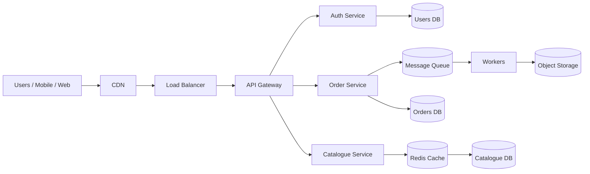

# 01 · System Design

## Purpose
System design is the process of turning **business requirements** into a **technical blueprint** that defines components, data flow, scale targets, and failure behaviour — *before* writing code. This document gives a repeatable method and the core building blocks.

## When to use
- Starting a new product or a major feature
- Expecting a jump in traffic (10x users, new region, marketing launch)
- Recurring incidents point to structural problems (timeouts, DB overload)
- Preparing a design review or an RFC

## Use cases
| Scenario | Key design concern |
|---|---|
| E-commerce checkout | Consistency, idempotency, payment reliability |
| Social feed | Read-heavy, caching, fan-out |
| Chat app | Real-time, WebSockets, presence, message ordering |
| Video streaming | CDN, storage, transcoding pipelines |
| Analytics dashboard | Batch/stream processing, OLAP DB |
| URL shortener | Simple, high read QPS, key generation |

---

## User guide (non-technical)
Think of system design like an **architect's floor plan** for a building:
- **Requirements** = how many people live there, what rooms they need.
- **Components** = rooms (login, catalogue, cart, payments).
- **Scalability** = can we add floors when more people move in?
- **Reliability** = if one elevator breaks, can people still use the stairs?

What you should provide to the engineering team:
1. Expected number of users (today and in 1 year)
2. Critical journeys (e.g., "user must be able to pay even during sales")
3. Acceptable downtime (e.g., "5 minutes per month")
4. Compliance needs (GDPR, PCI-DSS, HIPAA)

---

## Developer guide

### Step 1 — Clarify requirements
**Functional:** what the system does (e.g., "users can upload images").
**Non-functional (NFRs):**

| NFR | Example target |
|---|---|
| Availability | 99.9% (≈ 43 min downtime/month) |
| Latency | p95 < 200 ms for reads |
| Throughput | 2,000 requests/sec peak |
| Durability | No data loss on single node failure |
| Consistency | Strong for payments, eventual for feed |
| Security | OAuth2, encryption at rest & in transit |

### Step 2 — Back-of-the-envelope estimation
```
DAU                 = 1,000,000
Requests/user/day   = 20
Total/day           = 20,000,000
Avg QPS             = 20M / 86,400 ≈ 230
Peak QPS (x5)       ≈ 1,150
Storage/day         = 20M × 1 KB = 20 GB  → ~7.3 TB/year
```

### Step 3 — High-level design


### Step 4 — Core building blocks

| Block | Purpose | When to use | Tools | Drawbacks |
|---|---|---|---|---|
| **Load balancer** | Spread traffic across instances | >1 instance | NGINX, HAProxy, AWS ALB | Extra hop; misconfigured health checks cause outages |
| **CDN** | Serve static/edge-cached content | Global users, static assets | Cloudflare, CloudFront, Akamai | Cache invalidation complexity, cost at scale |
| **Cache** | Reduce DB reads & latency | Read-heavy, hot data | Redis, Memcached | Stale data, cache stampede, memory cost |
| **Message queue** | Decouple, async, buffer spikes | Emails, payments webhooks, jobs | RabbitMQ, SQS, Kafka | Eventual consistency, harder debugging |
| **API gateway** | Single entry, auth, rate-limit | Microservices | Kong, AWS API GW, Apigee | Single point of failure if not HA |
| **Object storage** | Files, images, backups | Large binary data | S3, GCS, Azure Blob | Not for transactional data |
| **Search index** | Full-text, faceted search | Product search, logs | Elasticsearch, OpenSearch, Meilisearch | Sync lag, ops-heavy |
| **Rate limiter** | Protect from abuse | Public APIs, login | Redis + token bucket, gateway plugins | False positives for shared IPs |

### Step 5 — Scaling strategies
| Strategy | Description | Drawback |
|---|---|---|
| **Vertical scaling** | Bigger machine | Hard ceiling, single point of failure |
| **Horizontal scaling** | More machines | Needs stateless services, LB |
| **Read replicas** | Offload reads from primary DB | Replication lag → stale reads |
| **Sharding** | Split data by key across DBs | Cross-shard queries/joins are painful, resharding is hard |
| **Caching** | Keep hot data in memory | Invalidation is "one of the two hard problems" |
| **Async processing** | Move slow work to queues | Users don't get immediate results |
| **CQRS** | Separate read & write models | More code, eventual consistency |

### Step 6 — Caching patterns
| Pattern | How | Best for | Drawback |
|---|---|---|---|
| Cache-aside | App reads cache → miss → DB → fill cache | General purpose | First request slow; stale on update |
| Write-through | Write cache + DB together | Read-after-write consistency | Write latency higher |
| Write-behind | Write cache, flush to DB async | Write-heavy | Data loss risk if cache dies |
| Read-through | Cache loads from DB itself | Simplifies app code | Needs cache provider support |

### Step 7 — CAP & consistency
- **CAP:** in a network partition you choose **Consistency** or **Availability**.
- **CP** (e.g., banking ledger, inventory): reject requests rather than serve wrong data.
- **AP** (e.g., social likes, feed): serve possibly-stale data, reconcile later.
- **PACELC:** even without partitions you trade **Latency vs Consistency**.

### Step 8 — Reliability patterns
| Pattern | Purpose |
|---|---|
| Retries with exponential backoff + jitter | Recover from transient failures |
| Circuit breaker | Stop hammering a failing dependency |
| Timeouts everywhere | Prevent thread/connection exhaustion |
| Bulkheads | Isolate failures to a pool |
| Idempotency keys | Make retries safe (critical for payments) |
| Dead-letter queue | Park poison messages for inspection |
| Graceful degradation | Show cached/partial results instead of errors |

### Step 9 — Document it (design doc template)
```markdown
# Title
## Context & problem
## Goals / Non-goals
## Requirements (functional + NFR)
## Estimations
## High-level design (diagram)
## Data model
## API contracts
## Alternatives considered (and why rejected)
## Risks & drawbacks
## Rollout & rollback plan
## Open questions
```

---

## Drawbacks & trade-offs of doing system design
| Drawback | Mitigation |
|---|---|
| **Over-engineering** — designing for 100M users when you have 100 | Design for 10x current, not 1000x |
| **Analysis paralysis** — weeks of diagrams, no code | Time-box design (e.g., 1–3 days per feature) |
| **Designs go stale** quickly | Keep docs next to code, review quarterly |
| **Estimates are guesses** | Validate with load tests early |
| **Distributed systems add failure modes** | Start simple; add components only when a bottleneck is proven |

## Checklist
- [ ] Functional & non-functional requirements written down
- [ ] Capacity estimate done (QPS, storage, bandwidth)
- [ ] High-level diagram created
- [ ] Single points of failure identified
- [ ] Data consistency needs defined per domain
- [ ] Failure modes & retries/timeouts defined
- [ ] Alternatives & drawbacks documented
- [ ] Reviewed by at least one other engineer

## Related docs
[Architecture](02-architecture.md) · [Database Selection](08-database-selection.md) · [API Design](09-api-design.md) · [Observability](11-observability.md)
