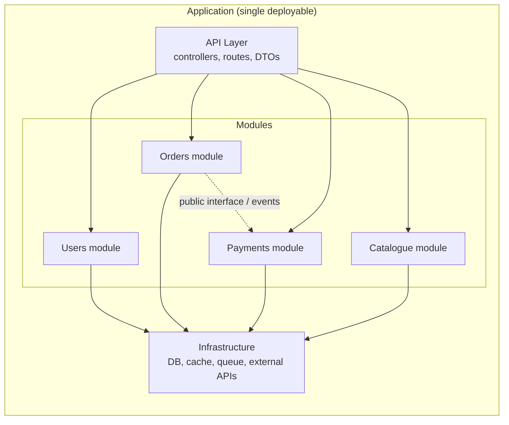
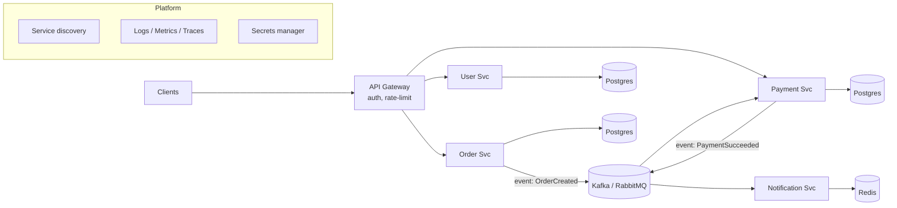
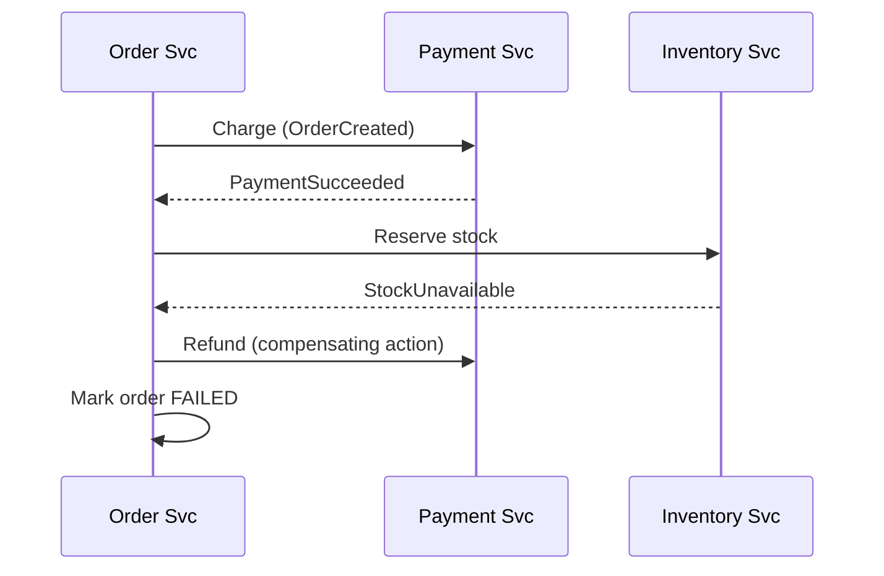

# 02 · Architecture Details

## Purpose
Architecture describes **how the codebase and services are organised** — boundaries, layers, communication styles, and deployment units. This document compares the main architectural styles, shows when to pick each, and lays out a recommended default.

## When to use
- Choosing a structure for a new application
- Deciding whether to split a monolith
- Onboarding developers to the codebase layout
- Reviewing whether the current architecture still fits team size and scale

## Use cases
| Situation | Recommended style |
|---|---|
| MVP / startup, 1–5 devs | Monolith or modular monolith |
| Growing product, 5–30 devs, clear domains | Modular monolith → selective microservices |
| Large org, many teams, independent release cycles | Microservices |
| Spiky / event-based workloads, low ops budget | Serverless |
| Real-time integrations, audit trails | Event-driven |
| Content sites, marketing pages | JAMstack / static + APIs |

---

## User guide (non-technical)
- **Monolith** = one big shop where every department is under one roof. Easy to manage, but a fire in one department can close the whole shop.
- **Microservices** = a shopping mall of independent shops. Each can open/close/renovate on its own, but you need security, parking, and signage for the whole mall.
- **Serverless** = renting a pop-up stall only when customers show up. Cheap when quiet, but you don't control the building.

What it means for you:
- Release frequency, outage blast radius, and cost all depend on architecture.
- Ask engineering: *"If feature X breaks, what else goes down?"*

---

## Developer guide

### 1. Architectural styles compared

| Style | Description | Pros | Drawbacks | Pick when |
|---|---|---|---|---|
| **Monolith** | Single codebase, single deployable | Simple dev, debugging, deploy; no network calls between modules | Grows into "big ball of mud"; whole app redeploys for every change; scales only as a unit | MVP, small team, unclear domains |
| **Modular monolith** | One deployable, strict internal module boundaries | Monolith simplicity + clean boundaries; easy future extraction | Boundaries need discipline/tooling to enforce; still one scaling unit | **Default choice** for most new products |
| **Microservices** | Many small independently deployable services | Independent deploy/scale; team autonomy; tech diversity | Network latency, distributed transactions, observability burden, high ops cost | Many teams, proven domains, need independent scaling |
| **Serverless (FaaS)** | Functions triggered by events, managed infra | Zero idle cost, auto-scale, no servers | Cold starts, vendor lock-in, execution time limits, hard local testing | Spiky workloads, glue code, cron, webhooks |
| **Event-driven** | Services communicate via events on a broker | Loose coupling, audit trail, easy to add consumers | Eventual consistency, debugging flows is hard, schema evolution | Integrations, analytics, workflows |
| **Layered (N-tier)** | Presentation → Business → Data | Familiar, simple | Changes ripple through layers; anemic domain risk | CRUD-heavy apps |
| **Hexagonal / Clean** | Domain core isolated via ports & adapters | Testable, framework-independent | More boilerplate; overkill for simple CRUD | Complex business logic |

### 2. Recommended default: Modular Monolith with Clean layers



Rules:
1. Modules talk **only via public interfaces or events** — never import another module's internals.
2. Each module owns its **own tables**; no cross-module joins.
3. Domain logic has **no framework imports** (testable in isolation).

### 3. Suggested folder structure
```
src/
├── api/                 # HTTP/GraphQL entry points, middleware
├── modules/
│   ├── users/
│   │   ├── domain/      # entities, value objects, business rules
│   │   ├── application/ # use cases / services
│   │   ├── infra/       # repositories, external adapters
│   │   └── index.ts     # public interface of the module
│   ├── orders/
│   └── payments/
├── shared/              # cross-cutting: logging, config, errors
└── main.ts              # composition root / bootstrap
tests/
docs/
```

### 4. Microservices reference architecture (when you outgrow the monolith)



Must-haves before going microservices:
- [ ] CI/CD per service
- [ ] Centralised logging + distributed tracing
- [ ] Service discovery / service mesh or gateway
- [ ] Contract testing between services
- [ ] On-call and runbooks per service

### 5. Communication styles

| Style | Example | Use when | Drawback |
|---|---|---|---|
| Sync REST/HTTP | `GET /orders/123` | Need immediate answer | Temporal coupling; cascading failures |
| Sync gRPC | Internal service calls | Low latency, typed contracts | Browser support limited; harder debugging |
| Async messaging | Queue (SQS, RabbitMQ) | Background jobs, commands | Eventual consistency |
| Event streaming | Kafka topics | Many consumers, replay, analytics | Operational complexity, ordering per partition only |
| WebSockets / SSE | Live notifications | Real-time UI | Stateful connections; scaling is harder |

### 6. Distributed transactions — the Saga pattern
In microservices you can't use one DB transaction across services. Use a **Saga**:


- **Choreography** (events only): simple, but flow is implicit.
- **Orchestration** (central coordinator, e.g., Temporal, AWS Step Functions): explicit, but coordinator is a dependency.

### 7. Architecture Decision Records (ADRs)
Record every significant decision in `docs/adr/NNNN-title.md`:
```markdown
# ADR-0003: Use PostgreSQL as primary database
Status: Accepted
Context: ...
Decision: ...
Consequences (positive & negative): ...
```

---

## Drawbacks & trade-offs summary
| Risk | Description | Mitigation |
|---|---|---|
| Premature microservices | Distributed monolith: all the cost, none of the benefit | Start modular monolith; extract only on proven need |
| Leaky module boundaries | Monolith decays into spaghetti | Lint rules (e.g., dependency-cruiser, ArchUnit) |
| Vendor lock-in (serverless) | Hard to migrate | Keep domain logic in plain libraries |
| Operational overhead | More services = more dashboards, alerts, on-call | Platform team, templates, IaC |
| Data consistency | Cross-service data drift | Sagas, outbox pattern, idempotent consumers |

## Checklist
- [ ] Architecture style chosen and justified in an ADR
- [ ] Module/service boundaries mapped to business domains
- [ ] Communication style chosen per interaction
- [ ] Data ownership defined (one owner per table)
- [ ] Failure handling between components defined
- [ ] Folder structure documented

## Related docs
[System Design](01-system-design.md) · [API Design](09-api-design.md) · [Deployment Flow](07-deployment-flow.md)
