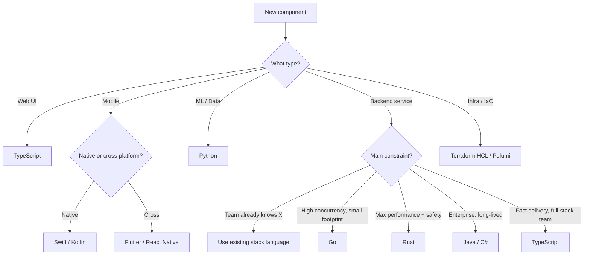

# 03 · Programming Languages — Use Cases, Selection & Drawbacks

## Purpose
Help teams **choose the right language for the job** by listing common languages, where they shine, where they don't, and a decision process — so language choices are deliberate, not accidental.

## When to use
- Starting a new service, app, script, or data pipeline
- Evaluating a rewrite or migration
- Hiring planning (language affects talent pool)
- Reviewing a proposal that introduces a new language into the stack

## Use cases at a glance
| Need | First choice | Strong alternatives |
|---|---|---|
| Web frontend (SPA) | TypeScript (React / Angular / Vue) | JavaScript |
| REST/GraphQL backend | TypeScript (Node.js), Python, Go, Java/Kotlin, C# | Ruby, PHP |
| High-performance microservice | Go | Rust, Java, C# |
| Data science / ML / AI | Python | R, Julia |
| Android app | Kotlin | Java, Flutter (Dart), React Native |
| iOS app | Swift | Flutter, React Native |
| Cross-platform mobile | Dart (Flutter) | TypeScript (React Native) |
| Systems / embedded / low latency | Rust | C, C++ |
| Enterprise backend | Java (Spring), C# (.NET) | Kotlin |
| Scripting / automation | Python, Bash / PowerShell | Node.js |
| Infrastructure as Code | HCL (Terraform), YAML | TypeScript/Python (Pulumi, CDK) |
| Big data processing | Scala / Python (Spark) | Java |
| Database queries | SQL | — |
| Smart contracts | Solidity | Rust (Solana) |

---

## User guide (non-technical)
- Language choice affects **hiring cost, delivery speed, performance, and long-term maintenance**.
- "Fast to write" (Python, JavaScript) ≠ "fast to run" (Go, Rust, C++).
- Fewer languages in one company = easier hiring and code sharing. Each new language needs a good reason.

---

## Developer guide

### 1. Language profiles

#### TypeScript / JavaScript
- **Where:** Web frontends, Node.js backends, serverless, CLIs, React Native, Electron desktop apps.
- **When to select:** Full-stack teams wanting one language end-to-end; I/O-heavy APIs; rapid prototyping.
- **Frameworks:** React, Next.js, Angular, Vue, NestJS, Express, Fastify.
- **Strengths:** Huge ecosystem (npm), one language front+back, great async I/O, TypeScript adds static typing.
- **Drawbacks:**
  - Single-threaded event loop → poor for CPU-heavy work
  - npm dependency sprawl & supply-chain risk
  - Ecosystem churn (frameworks change fast)
  - TS types are erased at runtime — still need runtime validation (zod, class-validator)

#### Python
- **Where:** Data science, ML/AI, automation, backend APIs, scripting, ETL.
- **When to select:** AI/ML work, data pipelines, quick internal tools, teams with data scientists.
- **Frameworks:** Django, FastAPI, Flask, Pandas, NumPy, PyTorch, TensorFlow, Airflow.
- **Strengths:** Readable, massive scientific/AI ecosystem, fast development.
- **Drawbacks:**
  - Slower runtime; GIL limits CPU parallelism (improving with free-threaded builds)
  - Dynamic typing → runtime errors unless you use type hints + mypy/pyright
  - Packaging/dependency management historically messy (use uv / poetry)
  - Higher memory usage

#### Java
- **Where:** Enterprise backends, banking, large-scale systems, Android (legacy), big data (Hadoop, Kafka).
- **When to select:** Large teams, long-lived systems, strong need for stability and tooling.
- **Frameworks:** Spring Boot, Quarkus, Micronaut, Hibernate.
- **Strengths:** Mature, fast JVM, excellent tooling, strong typing, huge talent pool.
- **Drawbacks:**
  - Verbose (improving with records, var)
  - JVM startup time & memory (mitigated by GraalVM native images)
  - Framework "magic" (annotations) can hide behaviour

#### Kotlin
- **Where:** Android (official), JVM backends (Spring, Ktor), Kotlin Multiplatform.
- **When to select:** Android apps; modern alternative to Java on JVM.
- **Strengths:** Concise, null-safety, coroutines, 100% Java interop.
- **Drawbacks:** Slower compile times; smaller backend community than Java; multiplatform still maturing.

#### C# (.NET)
- **Where:** Enterprise apps, Windows apps, Azure-centric backends, games (Unity).
- **When to select:** Microsoft/Azure shops, game dev with Unity, high-performance web APIs (ASP.NET Core).
- **Strengths:** Excellent performance, great tooling (Visual Studio/Rider), LINQ, async/await, cross-platform with .NET.
- **Drawbacks:** Ecosystem historically Windows-centric; some libraries/licensing tied to Microsoft ecosystem.

#### Go (Golang)
- **Where:** Cloud-native services, CLIs, DevOps tools (Docker, Kubernetes, Terraform are written in Go), networking.
- **When to select:** High-concurrency microservices, infra tooling, need small static binaries.
- **Strengths:** Simple language, fast compile, goroutines for concurrency, single binary deploy, low memory.
- **Drawbacks:**
  - Verbose error handling (`if err != nil`)
  - Limited expressiveness (generics are recent and basic)
  - Smaller ecosystem for web UIs, ML, and ORMs

#### Rust
- **Where:** Systems programming, performance-critical services, WebAssembly, embedded, blockchain.
- **When to select:** Need C/C++ speed with memory safety; latency-critical or safety-critical paths.
- **Strengths:** Memory safety without GC, zero-cost abstractions, excellent performance, great tooling (cargo).
- **Drawbacks:**
  - Steep learning curve (ownership, borrow checker, lifetimes)
  - Slow compile times
  - Smaller hiring pool; slower initial development

#### C / C++
- **Where:** OS kernels, embedded devices, game engines, high-frequency trading, drivers.
- **When to select:** Hardware-level control, existing C/C++ codebases, extreme performance.
- **Strengths:** Maximum performance & control, runs everywhere.
- **Drawbacks:** Manual memory management → security vulnerabilities (buffer overflows, use-after-free); complex build systems; slow development.

#### Swift
- **Where:** iOS, macOS, watchOS, tvOS apps.
- **When to select:** Native Apple apps needing best performance/UX.
- **Strengths:** Modern, safe, fast, SwiftUI.
- **Drawbacks:** Mostly Apple-only; needs macOS for builds; separate codebase from Android.

#### Dart (Flutter)
- **Where:** Cross-platform mobile, web, desktop from one codebase.
- **When to select:** One team must ship iOS + Android quickly with custom UI.
- **Strengths:** Single codebase, hot reload, consistent UI.
- **Drawbacks:** Larger app size; Dart is niche outside Flutter; native features may need platform channels.

#### PHP
- **Where:** CMS (WordPress), web apps (Laravel), shared hosting.
- **When to select:** WordPress/Laravel ecosystem, cheap hosting, content sites.
- **Strengths:** Easy deployment, huge CMS ecosystem, modern PHP 8 is fast.
- **Drawbacks:** Legacy reputation, inconsistent standard library, less suited for long-running/real-time processes.

#### Ruby
- **Where:** Web apps with Ruby on Rails, startups, internal tools.
- **When to select:** Rapid CRUD product development with conventions.
- **Strengths:** Developer happiness, Rails productivity.
- **Drawbacks:** Slower runtime, shrinking talent pool, scaling needs care.

#### SQL
- **Where:** Every relational DB (PostgreSQL, MySQL, SQL Server, Oracle), analytics warehouses.
- **When to select:** Always for relational data querying/reporting.
- **Drawbacks:** Dialect differences between vendors; complex queries are hard to test & refactor; ORMs can generate inefficient SQL.

#### Bash / PowerShell
- **Where:** CI scripts, server automation, glue tasks.
- **When to select:** Short automation (<100 lines) close to the OS.
- **Drawbacks:** Error-prone at scale, poor testability, platform-specific. Move to Python/Go when scripts grow.

#### Scala
- **Where:** Big data (Apache Spark), functional JVM backends (Akka/Pekko).
- **Drawbacks:** Complex type system, slow compiles, smaller talent pool.

#### R
- **Where:** Statistics, academic research, data visualisation.
- **Drawbacks:** Not suited for production services; slower; niche outside analytics.

### 2. Comparison matrix
| Language | Runtime speed | Dev speed | Learning curve | Concurrency | Ecosystem | Hiring pool |
|---|---|---|---|---|---|---|
| TypeScript | ●●●○○ | ●●●●● | ●●○○○ | Async I/O | ●●●●● | ●●●●● |
| Python | ●●○○○ | ●●●●● | ●○○○○ | Limited (GIL) | ●●●●● | ●●●●● |
| Java | ●●●●○ | ●●●○○ | ●●●○○ | Threads, virtual threads | ●●●●● | ●●●●● |
| Kotlin | ●●●●○ | ●●●●○ | ●●●○○ | Coroutines | ●●●●○ | ●●●○○ |
| C# | ●●●●○ | ●●●●○ | ●●●○○ | async/await | ●●●●○ | ●●●●○ |
| Go | ●●●●○ | ●●●●○ | ●●○○○ | Goroutines | ●●●○○ | ●●●○○ |
| Rust | ●●●●● | ●●○○○ | ●●●●● | Async + threads | ●●●○○ | ●●○○○ |
| C++ | ●●●●● | ●○○○○ | ●●●●● | Threads | ●●●●○ | ●●●○○ |

### 3. Decision process — how to select

Selection criteria (score 1–5 each):
1. **Team expertise** — most important factor
2. **Ecosystem fit** — libraries for your domain exist?
3. **Performance needs** — measured, not guessed
4. **Hiring & long-term maintenance**
5. **Operational fit** — container size, cold start, memory
6. **Consistency with existing stack**

### 4. Policy: introducing a new language
1. Write an ADR (see [Architecture](02-architecture.md#7-architecture-decision-records-adrs)) explaining why existing languages don't fit.
2. Identify at least 2 engineers able to maintain it.
3. Provide CI templates, linting, testing setup.
4. Pilot on a non-critical service first.

---

## Drawbacks of polyglot (multi-language) stacks
| Drawback | Impact |
|---|---|
| Knowledge silos | Only a few people can fix certain services |
| Duplicate tooling | CI, linting, security scanning per language |
| Harder code sharing | Shared logic must be rewritten or exposed via APIs |
| Hiring complexity | Need broader skill sets |
| Upgrade burden | Multiple runtimes to patch for security |

**Rule of thumb:** 1 frontend language + 1–2 backend languages + Python for data is plenty for most organisations.

## Checklist
- [ ] Language choice scored against selection criteria
- [ ] Team has (or can quickly gain) expertise
- [ ] Linting, formatting, testing tools defined
- [ ] CI pipeline template exists for the language
- [ ] ADR written if language is new to the stack

## Related docs
[Architecture](02-architecture.md) · [Tech Stack & Tools](13-tech-stack-and-tools.md) · [CI/CD Flow](05-ci-cd-flow.md)
