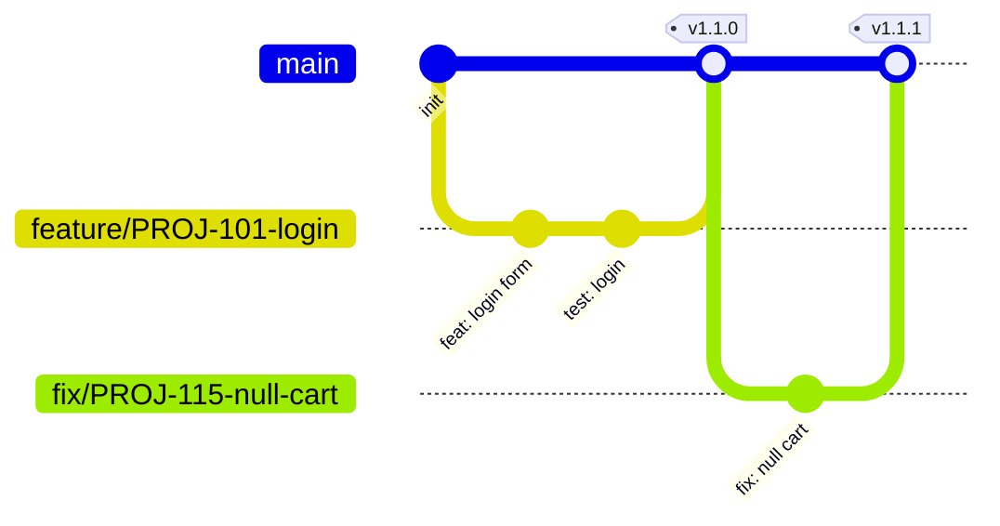

# 04 · Git Workflow

## Purpose
Define **how we use Git** — branching, commits, pull requests, reviews, and releases — so collaboration is predictable, history is readable, and production is always deployable.

## When to use
- Every day, for every code or docs change
- Setting up a new repository
- Onboarding a new contributor
- Planning a release or a hotfix

## Use cases
| Scenario | Workflow section |
|---|---|
| Building a new feature | [Feature flow](#3-day-to-day-feature-flow) |
| Fixing a production bug urgently | [Hotfix flow](#6-hotfix-flow) |
| Shipping a versioned release | [Releases & tagging](#7-releases--tagging) |
| Reviewing someone's code | [Pull requests](#5-pull-requests--code-review) |
| Undoing a mistake | [Recovery commands](#9-recovery-cheat-sheet) |

---

## User guide (non-technical)
- **Repository (repo):** the project folder with full history of every change.
- **Branch:** a safe copy where someone works on a change without affecting others.
- **Commit:** a saved snapshot with a message describing what changed.
- **Pull Request (PR) / Merge Request (MR):** a request to add a branch's changes to the main code, reviewed by teammates.
- **main branch:** the official, always-working version.
- **Tag / Release:** a named version (e.g., `v1.4.0`) — what QA tests and customers receive.

How to follow progress: watch PRs linked to your ticket (e.g., `PROJ-123`) — when the PR is merged, the change is on its way to deployment.

---

## Developer guide

### 1. Branching strategies — choose one

| Strategy | How it works | Best for | Drawbacks |
|---|---|---|---|
| **Trunk-based** | Short-lived branches (<2 days) merged to `main` frequently; feature flags hide incomplete work | CI/CD, SaaS, experienced teams | Needs strong tests and feature flags; discipline required |
| **GitHub Flow** | `main` + feature branches + PRs; deploy from `main` | Most web apps, small/medium teams | No explicit release staging; hotfix = normal PR |
| **GitFlow** | `main`, `develop`, `feature/*`, `release/*`, `hotfix/*` | Versioned products, mobile apps, scheduled releases | Heavy; long-lived branches → merge conflicts; slows CD |
| **Release branches** | `main` + `release/x.y` cut for stabilisation | Products supporting multiple versions | Back-porting fixes across branches is tedious |

**Recommended default:** GitHub Flow / trunk-based with short-lived branches.



### 2. Branch naming
```
<type>/<ticket-id>-<short-description>

feature/PROJ-101-user-login
fix/PROJ-115-null-cart-total
hotfix/PROJ-130-payment-timeout
chore/upgrade-node-22
docs/payment-flow
```

### 3. Day-to-day feature flow
```bash
# 1. Sync main
git checkout main
git pull --rebase origin main

# 2. Create branch
git checkout -b feature/PROJ-101-user-login

# 3. Work & commit in small logical steps
git add -p                       # stage hunks interactively-reviewed
git commit -m "feat(auth): add login form validation"

# 4. Keep up to date with main
git fetch origin
git rebase origin/main           # or: git merge origin/main

# 5. Push & open PR
git push -u origin feature/PROJ-101-user-login
gh pr create --fill              # GitHub CLI (optional)
```

### 4. Commit message convention — Conventional Commits
```
<type>(<scope>): <short summary in imperative mood>

<optional body: what & why, not how>

<optional footer: BREAKING CHANGE: ..., Refs: PROJ-101>
```

| Type | Use for |
|---|---|
| `feat` | New feature (→ minor version bump) |
| `fix` | Bug fix (→ patch bump) |
| `docs` | Documentation only |
| `style` | Formatting, no logic change |
| `refactor` | Code change, no feature/fix |
| `perf` | Performance improvement |
| `test` | Adding/fixing tests |
| `build` / `ci` | Build system or CI changes |
| `chore` | Maintenance, deps |
| `revert` | Reverts a commit |

`BREAKING CHANGE:` in the footer or `feat!:` → major version bump.

Tooling: **commitlint** + **husky** (JS) or **pre-commit** (Python) to enforce on commit.

### 5. Pull requests & code review
**PR template** (`.github/pull_request_template.md`):
```markdown
## What
## Why (link ticket)
## How tested
## Screenshots (UI changes)
## Checklist
- [ ] Tests added/updated
- [ ] Docs updated
- [ ] No secrets committed
```

Rules:
- Keep PRs **small** (< 400 lines changed ideally).
- At least **1 approval** (2 for payments/security code).
- CI must be green before merge.
- Author resolves conversations; reviewer approves.
- Use **CODEOWNERS** to auto-assign reviewers.

**Merge methods:**
| Method | Result | When | Drawback |
|---|---|---|---|
| Squash & merge | One commit per PR | Default — clean history | Loses granular commits |
| Rebase & merge | Linear history, all commits kept | Well-curated commits | Rewrites SHAs |
| Merge commit | Preserves branch topology | GitFlow / release merges | Noisy history |

**Reviewer guide:** check correctness → security → tests → readability → performance. Comment with prefixes: `nit:`, `question:`, `suggestion:`, `blocking:`.

### 6. Hotfix flow
```bash
git checkout main && git pull
git checkout -b hotfix/PROJ-130-payment-timeout
# fix + test
git commit -m "fix(payments): increase gateway timeout to 30s"
git push -u origin hotfix/PROJ-130-payment-timeout
# PR → expedited review → merge → tag → deploy
```
In GitFlow, also merge the hotfix back into `develop`.

### 7. Releases & tagging
Use **Semantic Versioning**: `MAJOR.MINOR.PATCH` (e.g., `2.3.1`).
```bash
git tag -a v1.4.0 -m "Release 1.4.0"
git push origin v1.4.0
```
Automate with **semantic-release**, **release-please**, or **changesets** — they read Conventional Commits, bump versions, generate `CHANGELOG.md`, and create GitHub releases.

### 8. Repository protection settings
- Protect `main`: no direct pushes, require PR + approvals + status checks
- Require linear history (optional)
- Require signed commits (optional, for high-security repos)
- Enable secret scanning & Dependabot/Renovate
- `.gitignore` for build output, `.env`, IDE files

### 9. Recovery cheat sheet
| Problem | Command |
|---|---|
| Undo last commit, keep changes | `git reset --soft HEAD~1` |
| Discard local changes to a file | `git restore <file>` |
| Unstage a file | `git restore --staged <file>` |
| Undo a pushed commit safely | `git revert <sha>` |
| Fix last commit message (not pushed) | `git commit --amend` |
| Find a lost commit | `git reflog` |
| Temporarily shelve work | `git stash` / `git stash pop` |
| Find commit that introduced a bug | `git bisect start / good / bad` |
| Committed a secret | **Rotate the secret immediately**, then purge with `git filter-repo` |

### 10. Git hosting platforms
| Platform | Strengths | Drawbacks |
|---|---|---|
| GitHub | Largest community, Actions, Copilot, great PR UX | Advanced security features cost extra |
| GitLab | Built-in CI/CD, self-hostable, all-in-one DevOps | UI heavier; self-hosting needs ops |
| Bitbucket | Jira integration, Atlassian ecosystem | Smaller ecosystem, Pipelines less flexible |
| Azure DevOps | Boards + Repos + Pipelines, enterprise Microsoft integration | Dated UX, less community |

---

## Drawbacks & trade-offs
| Issue | Description | Mitigation |
|---|---|---|
| Long-lived branches | Painful merge conflicts, integration surprises | Merge to main at least every 1–2 days, use feature flags |
| Rebasing shared branches | Rewrites history others depend on | Only rebase your own unpushed/personal branches |
| Large PRs | Superficial reviews, more bugs | Split by layer or feature flag |
| Strict conventions | Slows newcomers | Automate with hooks & templates, not memory |
| Squash merges | Lose detailed history | Write a good squash message summarising the PR |
| Monorepo vs polyrepo | Monorepo: tooling/CI scale issues; Polyrepo: cross-repo changes are hard | Pick based on team coupling; use Nx/Turborepo for monorepos |

## Checklist
- [ ] Branch named `<type>/<ticket>-<desc>`
- [ ] Commits follow Conventional Commits
- [ ] Rebased/merged with latest `main`
- [ ] PR template filled, ticket linked
- [ ] CI green, approvals received
- [ ] No secrets, no large binaries committed
- [ ] Branch deleted after merge

## Related docs
[CI/CD Flow](05-ci-cd-flow.md) · [Deployment Flow](07-deployment-flow.md) · [Security](10-security.md)
