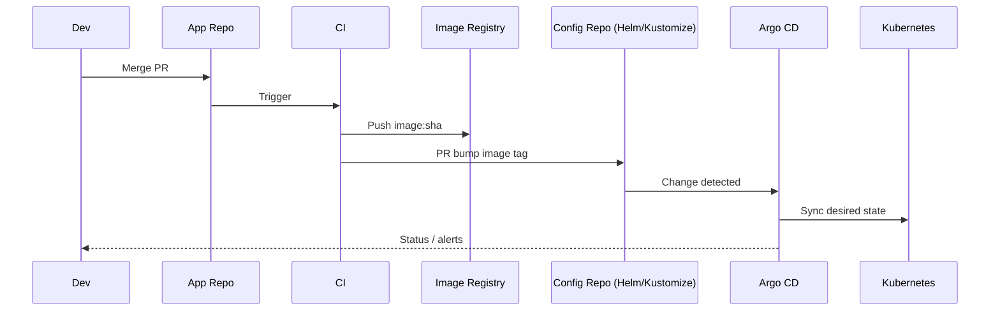

# 05 · CI/CD Flow

## Purpose
Describe **how code moves automatically from a commit to production** — building, testing, scanning, packaging, and deploying — with quality gates that catch problems early and make releases boring.

- **CI (Continuous Integration):** every change is automatically built and tested.
- **CD (Continuous Delivery):** every passing change is *ready* to deploy (manual approval to prod).
- **CD (Continuous Deployment):** every passing change is deployed to production *automatically*.

## When to use
- Every repository that produces deployable code, libraries, or infra
- Setting up a new project's pipeline
- Debugging a failing pipeline
- Adding a new quality/security gate

## Use cases
| Scenario | Pipeline behaviour |
|---|---|
| Developer opens PR | Lint, unit tests, build, security scan, preview env |
| PR merged to `main` | Build image, integration tests, deploy to staging |
| Tag `v*` pushed | Deploy to production (with approval) |
| Nightly schedule | Full E2E suite, dependency audit, performance tests |
| Infra change (Terraform) | `plan` on PR, `apply` on merge |

---

## User guide (non-technical)
- The pipeline is an **automatic assembly line**. Each station checks something (does it compile? do tests pass? is it secure?).
- ✅ Green = safe to continue. ❌ Red = something failed; the change is stopped before reaching customers.
- **Staging** is a rehearsal copy of production where QA and product can verify changes.
- Production deploys may require an **approval** click from a lead — this is your release gate.

---

## Developer guide

### 1. Pipeline overview

```mermaid
flowchart LR
    A[Commit / PR] --> B[Checkout & cache deps]
    B --> C[Lint & format check]
    C --> D[Unit tests + coverage]
    D --> E[Build artifact / Docker image]
    E --> F[Security scans<br/>SAST, deps, secrets, image]
    F --> G[Integration tests]
    G --> H[Push artifact to registry]
    H --> I[Deploy → Dev / Preview]
    I --> J[Deploy → Staging]
    J --> K[E2E + smoke tests]
    K --> L{Manual approval?}
    L -->|Approved| M[Deploy → Production]
    M --> N[Post-deploy smoke + monitoring]
    N -->|Failure| R[Auto rollback]
```


### 2. Stages explained
| Stage | Purpose | Tools | Fail-fast? |
|---|---|---|---|
| Lint / format | Consistent style, catch obvious bugs | ESLint, Prettier, Ruff, Black, golangci-lint, Checkstyle | Yes |
| Type check | Catch type errors | tsc, mypy, pyright | Yes |
| Unit tests | Verify logic in isolation | Jest, Vitest, pytest, JUnit, Go test | Yes |
| Coverage gate | Prevent untested code | Codecov, SonarQube | Yes (e.g., ≥80% on new code) |
| Build | Produce artifact | npm/pnpm, Maven/Gradle, Docker, go build | Yes |
| SAST | Static code security analysis | CodeQL, Semgrep, SonarQube | Yes for high/critical |
| Dependency scan (SCA) | Known CVEs in libraries | Dependabot, Snyk, npm audit, Trivy, OWASP Dependency-Check | High/critical |
| Secret scan | Leaked keys | Gitleaks, TruffleHog, GitHub secret scanning | Yes |
| Container scan | OS/package CVEs in image | Trivy, Grype, Docker Scout | High/critical |
| IaC scan | Misconfigured cloud resources | Checkov, tfsec, KICS | High |
| Integration tests | Service + real DB/queue | Testcontainers, docker-compose | Yes |
| E2E tests | User journeys in browser | Playwright, Cypress, Selenium | Yes in staging |
| DAST | Attack the running app | OWASP ZAP, Burp | Report / block criticals |
| Performance | Latency/throughput regressions | k6, JMeter, Gatling, Locust | Nightly / pre-release |
| Deploy | Release to environment | Argo CD, Flux, Helm, kubectl, Terraform, cloud CLIs | — |
| Smoke test | Verify deploy health | curl health checks, synthetic monitors | Triggers rollback |

### 3. CI/CD tools compared
| Tool | Type | Strengths | Drawbacks |
|---|---|---|---|
| **GitHub Actions** | Hosted CI/CD | Native to GitHub, huge marketplace, matrix builds | Minutes cost at scale; YAML sprawl; marketplace action supply-chain risk |
| **GitLab CI** | Hosted / self-hosted | Built into GitLab, strong DevSecOps features, environments | Tied to GitLab; complex YAML for large setups |
| **Jenkins** | Self-hosted | Extremely flexible, thousands of plugins | Ops-heavy, plugin hell, security patching burden |
| **CircleCI** | Hosted | Fast, good caching, orbs | Pricing; outages affect all users |
| **Azure Pipelines** | Hosted | Azure integration, Windows builds | Verbose YAML, dated UX |
| **AWS CodePipeline/CodeBuild** | Hosted | Deep AWS integration | AWS-only, clunky UX |
| **Bitbucket Pipelines** | Hosted | Simple, Jira integration | Limited for complex workflows |
| **Argo CD / Flux** | GitOps CD for Kubernetes | Git as source of truth, drift detection, easy rollback | Kubernetes-only; learning curve |
| **Tekton** | K8s-native CI/CD | Cloud-native, reusable tasks | Verbose, steep learning curve |

### 4. Sample: GitHub Actions (Node.js + Docker)
`.github/workflows/ci.yml`
```yaml
name: CI/CD

on:
  pull_request:
  push:
    branches: [main]
    tags: ['v*']

permissions:
  contents: read
  packages: write
  id-token: write          # for OIDC cloud auth (no long-lived secrets)

jobs:
  test:
    runs-on: ubuntu-latest
    steps:
      - uses: actions/checkout@v4
      - uses: actions/setup-node@v4
        with:
          node-version: 22
          cache: npm
      - run: npm ci
      - run: npm run lint
      - run: npm run typecheck
      - run: npm test -- --coverage

  security:
    runs-on: ubuntu-latest
    steps:
      - uses: actions/checkout@v4
      - uses: gitleaks/gitleaks-action@v2
      - run: npm audit --audit-level=high

  build:
    needs: [test, security]
    if: github.event_name == 'push'
    runs-on: ubuntu-latest
    steps:
      - uses: actions/checkout@v4
      - uses: docker/login-action@v3
        with:
          registry: ghcr.io
          username: ${{ github.actor }}
          password: ${{ secrets.GITHUB_TOKEN }}
      - uses: docker/build-push-action@v6
        with:
          push: true
          tags: ghcr.io/${{ github.repository }}:${{ github.sha }}

  deploy-staging:
    needs: build
    if: github.ref == 'refs/heads/main'
    environment: staging
    runs-on: ubuntu-latest
    steps:
      - run: echo "Deploy ${{ github.sha }} to staging"   # helm upgrade / argocd / cloud CLI

  deploy-prod:
    needs: build
    if: startsWith(github.ref, 'refs/tags/v')
    environment: production       # configure required reviewers in repo settings
    runs-on: ubuntu-latest
    steps:
      - run: echo "Deploy ${{ github.sha }} to production"
```

### 5. Sample: GitLab CI skeleton
```yaml
stages: [lint, test, build, scan, deploy]

lint:
  stage: lint
  script: npm ci && npm run lint

test:
  stage: test
  script: npm ci && npm test
  coverage: '/Lines\s*:\s*(\d+\.?\d*)%/'

build:
  stage: build
  script:
    - docker build -t $CI_REGISTRY_IMAGE:$CI_COMMIT_SHA .
    - docker push $CI_REGISTRY_IMAGE:$CI_COMMIT_SHA

deploy_prod:
  stage: deploy
  script: ./deploy.sh production
  environment: production
  when: manual
  only: [tags]
```

### 6. GitOps flow (Kubernetes)


### 7. Best practices
- **Build once, deploy many** — same artifact promoted through dev → staging → prod.
- **Fail fast** — cheapest checks first (lint before E2E).
- **Cache dependencies** and use parallel jobs / matrix builds.
- **Pin action/plugin versions** (ideally by commit SHA) to avoid supply-chain attacks.
- **Use OIDC** to authenticate to clouds instead of storing long-lived keys.
- **Secrets** live in the CI secret store / vault, never in YAML.
- **Ephemeral preview environments** per PR for UI review.
- **Pipeline as code**, reviewed like any other code.
- Keep the PR pipeline under **~10 minutes**.

### 8. Pipeline metrics (DORA)
| Metric | Elite target |
|---|---|
| Deployment frequency | On-demand (multiple/day) |
| Lead time for changes | < 1 day |
| Change failure rate | 0–15% |
| Time to restore service | < 1 hour |

---

## Drawbacks & trade-offs
| Drawback | Description | Mitigation |
|---|---|---|
| Slow pipelines | Developers wait, context-switch | Caching, parallelism, test splitting, run E2E only on main |
| Flaky tests | Erode trust; people re-run until green | Quarantine flaky tests, track flake rate |
| Cost | CI minutes & runners get expensive | Self-hosted runners, path filters, skip docs-only changes |
| YAML complexity | Hard to read/maintain | Reusable workflows/templates, composite actions |
| Supply-chain risk | Third-party actions/plugins can be compromised | Pin SHAs, least-privilege tokens, review actions |
| False security alerts | Alert fatigue from scanners | Tune rules, triage SLAs, block only high/critical |
| Continuous deployment risk | Bugs reach prod faster | Feature flags, canary deploys, automated rollback |
| Vendor lock-in | Migrating pipelines is costly | Keep logic in scripts/Makefiles; CI only orchestrates |

## Checklist
- [ ] Pipeline runs on every PR and on `main`
- [ ] Lint, type check, unit tests, build are required checks
- [ ] Secret, dependency, and container scans enabled
- [ ] Artifacts versioned by commit SHA / semver tag
- [ ] Staging deploy is automatic; prod has approval or canary
- [ ] Rollback is automated or documented
- [ ] Secrets via vault/OIDC, not hardcoded
- [ ] PR pipeline < 10 minutes

## Related docs
[Git Workflow](04-git-workflow.md) · [Deployment Flow](07-deployment-flow.md) · [Testing Strategy](12-testing-strategy.md) · [Security](10-security.md)
