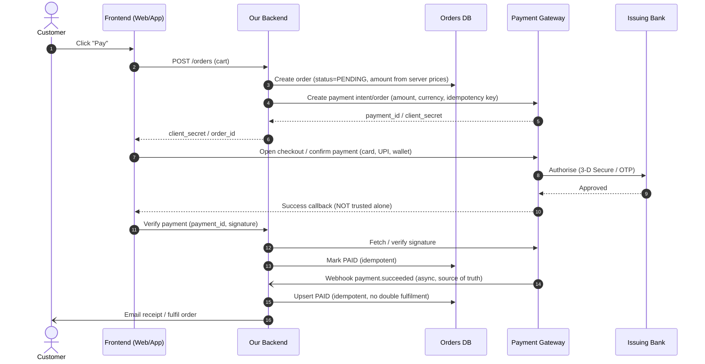
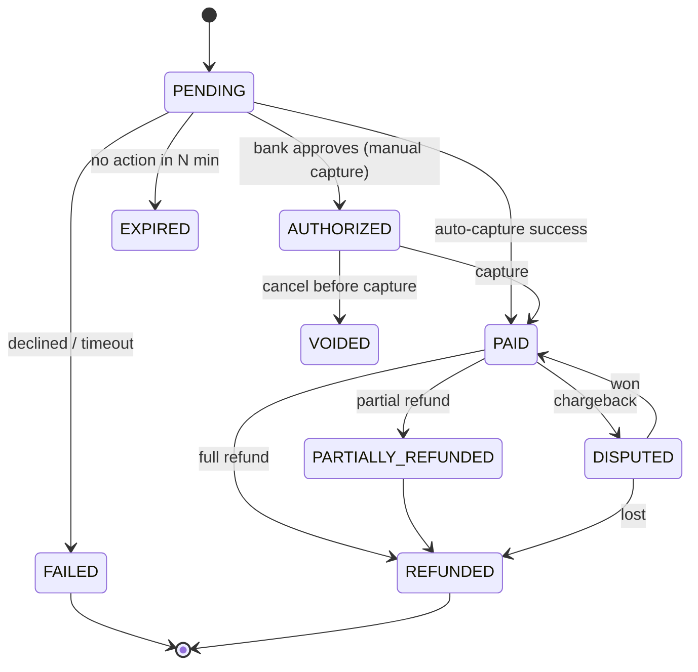
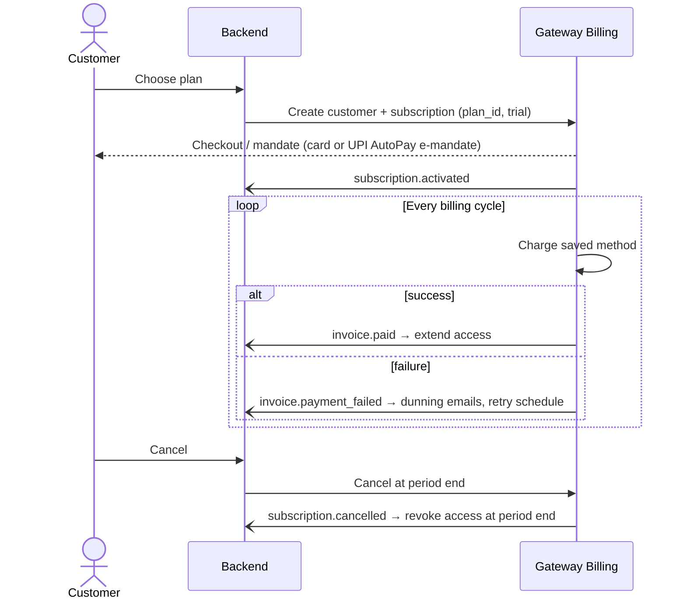
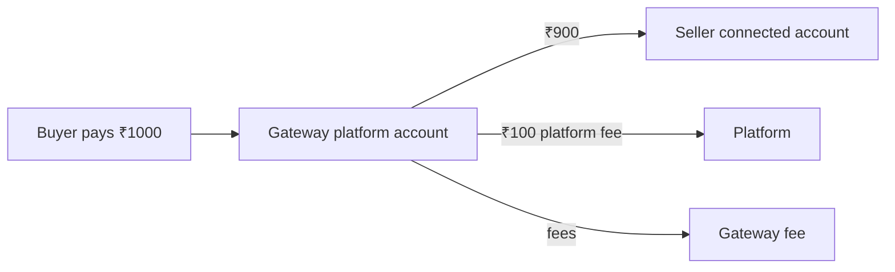

# 06 · Payment Integration Flows

## Purpose
Explain **how the application accepts, confirms, refunds, and reconciles payments** — which gateways and tools to use, the end-to-end flows, how to make them secure and reliable, and what can go wrong.

## When to use
- Adding checkout, subscriptions, or wallets to an app
- Choosing or switching a payment gateway
- Handling payment failures, refunds, disputes
- Preparing for PCI-DSS or regional compliance (RBI, PSD2/SCA)

## Use cases
| Use case | Typical flow | Example tools |
|---|---|---|
| One-time e-commerce purchase | Checkout → authorise & capture | Stripe Checkout, Razorpay Standard Checkout, PayPal |
| SaaS subscription | Recurring billing, trials, proration | Stripe Billing, Razorpay Subscriptions, Chargebee, Paddle |
| Marketplace (split payouts) | Collect from buyer, pay sellers minus fee | Stripe Connect, Razorpay Route, Adyen for Platforms |
| UPI / India payments | Intent / collect / QR | Razorpay, Cashfree, PayU, PhonePe PG, Paytm |
| In-app digital goods (mobile) | App store billing | Apple In-App Purchase, Google Play Billing, RevenueCat |
| Hotel/rental deposits | Authorise now, capture later | Stripe manual capture, Adyen |
| Wallet / top-up | Prepaid balance ledger | Gateway + internal ledger |
| Cash on delivery reconciliation | Offline → mark paid | Internal order system |

---

## User guide (non-technical)

### What happens when a customer pays
1. Customer clicks **Pay** — the payment page is shown by the **payment gateway** (we never see full card numbers).
2. The bank may ask for **OTP / 3-D Secure** verification.
3. The gateway tells us **success / failure**, and also sends a confirmation message to our server (**webhook**) to be sure.
4. The order is marked **Paid**, a receipt is emailed, and the money settles into our bank account in **T+1 to T+3 days** (gateway-dependent).

### Payment statuses you'll see in admin/support tools
| Status | Meaning | Support action |
|---|---|---|
| `created` / `pending` | Customer started but not finished | Wait; auto-expires |
| `authorized` | Bank approved & held funds, not yet captured | Capture or void |
| `captured` / `succeeded` | Money collected | None |
| `failed` | Declined / cancelled / error | Ask customer to retry or use another method |
| `refunded` / `partially_refunded` | Money returned | Refunds take 5–10 business days to show |
| `disputed` / `chargeback` | Customer disputed with bank | Submit evidence before deadline |

### Common customer questions
- *"Money deducted but order failed"* → usually auto-reversed by bank or reconciled by webhook within minutes–hours. Check payment ID in the dashboard.
- *"Refund not received"* → share the refund reference (ARN/RRN) with the customer for their bank.

---

## Developer guide

### 1. Payment gateway comparison
| Gateway | Regions | Strengths | Drawbacks |
|---|---|---|---|
| **Stripe** | Global (40+ countries) | Best developer experience, Billing, Connect, Radar fraud, great docs | Higher fees in some regions; account holds/freezes can happen; limited India domestic features |
| **Razorpay** | India | UPI, cards, netbanking, wallets, EMI, subscriptions, Route, fast onboarding | India-focused; international payments need approval |
| **PayPal / Braintree** | Global | Consumer trust, PayPal wallet, Venmo (US) | Higher fees, dispute handling favours buyers, frozen funds complaints |
| **Adyen** | Global, enterprise | Single platform for online + POS, many local methods, high auth rates | Minimum volume requirements, enterprise onboarding |
| **Cashfree / PayU / PhonePe PG** | India | Competitive pricing, payouts, UPI | Docs/SDK quality varies |
| **Square** | US, UK, AU, JP, CA | In-person POS + online | Limited regions |
| **Paddle / Lemon Squeezy** | Global (Merchant of Record) | They handle global sales tax/VAT for you | Higher fees, less control over checkout |
| **Apple IAP / Google Play Billing** | App stores | Required for digital goods in apps | 15–30% commission; strict rules |

**Selection criteria:** supported countries & methods (UPI, cards, wallets, BNPL), fees, settlement time, subscription support, marketplace payouts, SDK quality, fraud tools, compliance burden, dispute support.

### 2. Integration styles
| Style | How | PCI scope | Pros | Drawbacks |
|---|---|---|---|---|
| **Hosted / redirect checkout** | Redirect to gateway page | Lowest (SAQ A) | Fastest to build, gateway handles UI, 3DS, methods | Less UI control, user leaves your site |
| **Embedded / drop-in UI** | Gateway JS widget / iframe | Low (SAQ A) | Native feel, still PCI-light | Some styling limits |
| **Custom elements (tokenised)** | Card fields via gateway SDK (e.g., Stripe Elements) | Low–medium (SAQ A / A-EP) | Full design control | More code, handle 3DS states |
| **Direct API (raw card data)** | Your server handles card numbers | **Highest (SAQ D)** | Total control | **Avoid** — expensive audits, high risk |

**Recommended:** hosted checkout or embedded drop-in for most apps.

### 3. Core one-time payment flow (server-confirmed)


**Golden rules:**
1. **Amount is always calculated on the server** — never trust the price from the client.
2. **Webhook is the source of truth.** The frontend redirect may never arrive (user closes tab).
3. **Verify webhook signatures** (HMAC) before processing.
4. **Idempotency:** use idempotency keys when creating payments; dedupe webhook events by event ID.
5. **Store gateway IDs** (payment_id, order_id, refund_id) on your records for reconciliation.
6. **Never store raw card data** — store gateway tokens/customer IDs only.

### 4. Webhook handling (pseudo-code)
```ts
// POST /webhooks/payments
export async function handleWebhook(req, res) {
  const rawBody = req.rawBody;                         // must be raw, not parsed JSON
  const signature = req.headers['x-gateway-signature'];

  if (!verifyHmac(rawBody, signature, process.env.WEBHOOK_SECRET)) {
    return res.status(400).send('invalid signature');
  }

  const event = JSON.parse(rawBody);

  // Idempotency: skip if already processed
  const inserted = await db.processedEvents.insertIfNotExists(event.id);
  if (!inserted) return res.status(200).send('duplicate');

  // Respond fast; do heavy work async
  await queue.publish('payment-events', event);
  return res.status(200).send('ok');
}

// Worker
async function onPaymentEvent(event) {
  switch (event.type) {
    case 'payment.succeeded':
      await orders.markPaid(event.data.orderId, event.data.paymentId); // idempotent update
      await fulfilment.start(event.data.orderId);
      break;
    case 'payment.failed':
      await orders.markFailed(event.data.orderId, event.data.reason);
      break;
    case 'refund.processed':
      await orders.markRefunded(event.data.orderId, event.data.amount);
      break;
    case 'dispute.created':
      await alerts.notifyFinance(event);
      break;
  }
}
```

### 5. Order / payment state machine


### 6. Subscription / recurring billing flow

Considerations: proration on plan change, grace periods, dunning (smart retries), tax/VAT/GST invoices, India RBI e-mandate rules for recurring card/UPI payments.

### 7. Refund flow
1. Support/admin triggers refund in our admin panel (role-restricted, audited).
2. Backend calls gateway refund API with an **idempotency key**.
3. Gateway returns `refund_id` (status `pending`).
4. Webhook `refund.processed` → update order, notify customer.
5. Bank credits customer in 5–10 business days.

### 8. Marketplace / split payments

Tools: Stripe Connect, Razorpay Route, Adyen for Platforms. Requires seller KYC onboarding.

### 9. Reconciliation
Run a **daily job** that compares:
- Our DB orders (PAID, REFUNDED) ↔ gateway transactions report/API ↔ bank settlement report.
- Flag mismatches: paid at gateway but pending in DB (missed webhook), refund mismatches, fee discrepancies.

### 10. Security & compliance
| Requirement | What to do |
|---|---|
| **PCI-DSS** | Use hosted/tokenised checkout to stay at SAQ A; never log card data |
| **3-D Secure / SCA (PSD2)** | Use gateway SDKs that handle authentication challenges |
| **Webhook security** | Verify HMAC signatures, use HTTPS, optionally allowlist gateway IPs |
| **Secrets** | API keys in a secrets manager; separate test vs live keys; rotate |
| **Fraud** | Gateway fraud tools (Stripe Radar, Razorpay Thirdwatch), velocity limits, address/CVV checks |
| **Audit** | Log every payment state change with actor & timestamp |
| **Data residency** | India: RBI data localisation for payment data |
| **Tax** | GST/VAT invoices; consider Merchant of Record (Paddle) for global tax |

### 11. Testing payments
- Use gateway **test mode** keys and test cards / UPI IDs (e.g., Stripe `4242 4242 4242 4242`, failure & 3DS test cards).
- Test webhooks locally: `stripe listen --forward-to localhost:3000/webhooks`, or ngrok / cloudflared tunnels.
- Test scenarios: success, decline, 3DS challenge, network timeout, duplicate webhook, webhook arrives before redirect, refund, partial refund, subscription renewal failure.

### 12. Tools used across the payment stack
| Purpose | Tools |
|---|---|
| Gateways | Stripe, Razorpay, PayPal/Braintree, Adyen, Cashfree, PayU |
| Subscription management | Stripe Billing, Chargebee, Recurly, Razorpay Subscriptions |
| Mobile in-app | Apple StoreKit, Google Play Billing, RevenueCat |
| Merchant of Record / tax | Paddle, Lemon Squeezy, Stripe Tax |
| Webhook testing | Stripe CLI, ngrok, Hookdeck, webhook.site |
| Fraud | Stripe Radar, Sift, Signifyd |
| Reconciliation / ledger | Internal double-entry ledger, Modern Treasury, Formance |

---

## Drawbacks & trade-offs
| Drawback | Description | Mitigation |
|---|---|---|
| Gateway dependency | Outage = no revenue | Monitor gateway status; consider secondary gateway / smart routing for high volume |
| Vendor lock-in | Saved cards/tokens are gateway-specific | Abstract gateway behind an internal `PaymentProvider` interface; request token migration support |
| Fees | 2–3% + fixed fee per transaction; FX fees | Negotiate at volume; prefer UPI/bank transfers where fee is lower |
| Missed/duplicate webhooks | Orders stuck or double fulfilled | Idempotency + reconciliation job + polling fallback |
| Chargebacks | Lost revenue + fees | Clear descriptors, good receipts, fraud tools, evidence submission |
| Account holds/freezes | Gateway risk teams can hold funds | Complete KYC, clear refund policy, avoid sudden volume spikes without notice |
| Compliance overhead | PCI, RBI, SCA, tax rules change | Use hosted flows, Merchant of Record, follow gateway updates |
| App store commissions | 15–30% on digital goods | Follow store rules; web checkout where allowed |
| Multi-currency complexity | Rounding, FX, settlement currency | Store amounts as integers in minor units (paise/cents) + currency code |

## Checklist
- [ ] Amount computed server-side, stored in minor units with currency
- [ ] Hosted/tokenised checkout (no raw card data on our servers)
- [ ] Idempotency keys on create/refund calls
- [ ] Webhook signature verified, events deduplicated
- [ ] Webhook processing is async and idempotent
- [ ] State machine enforced (no invalid transitions)
- [ ] Daily reconciliation job in place
- [ ] Test & live keys separated, stored in secrets manager
- [ ] Failure, 3DS, refund, dispute scenarios tested
- [ ] Payment events logged and monitored with alerts

## Related docs
[Security](10-security.md) · [API Design](09-api-design.md) · [Observability](11-observability.md) · [System Design](01-system-design.md)
