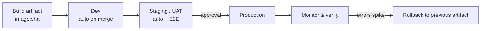
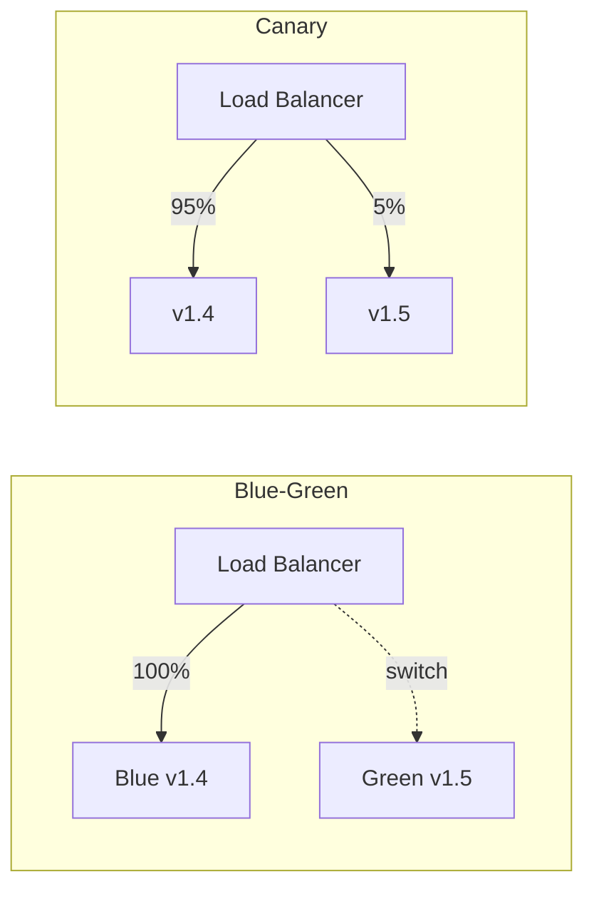

# 07 · Deployment Flow

## Purpose
Describe **how a tested build becomes a running release** — environments, hosting options, deployment strategies, infrastructure as code, configuration, and rollback — so deployments are safe, repeatable, and reversible.

## When to use
- Releasing any change to dev, staging, or production
- Choosing hosting for a new service
- Planning a risky release (DB migration, big feature)
- During an incident needing rollback

## Use cases
| Scenario | Recommended strategy |
|---|---|
| Routine backend change | Rolling update |
| High-risk change, need instant rollback | Blue-green |
| Large user base, validate with real traffic | Canary |
| Unfinished feature merged to main | Feature flag (dark launch) |
| Static website / SPA | Atomic deploy to CDN (Vercel, Netlify, S3+CloudFront) |
| Mobile app | Phased store rollout + remote config |
| Database schema change | Expand-and-contract migration |

---

## User guide (non-technical)
- **Environments:**
  - **Dev** — developers' playground, can break anytime.
  - **Staging / UAT** — copy of production for QA and business sign-off.
  - **Production** — what real customers use.
- **Release window:** prefer deploying during working hours with the team available — not Friday evening.
- **Rollback** means returning to the previous working version, usually within minutes.
- **Feature flags** let us turn features on/off for certain users without redeploying.
- You'll be notified in the release channel with version, changes (changelog), and status.

---

## Developer guide

### 1. Environment promotion


| Env | Data | Deploy trigger | Access |
|---|---|---|---|
| Local | Seed/mock | Developer | Developer |
| Dev / Preview | Synthetic | Every PR / merge | Team |
| Staging | Anonymised prod-like | Merge to main | Team + QA + business |
| Production | Real | Tag / approval | Restricted, audited |

**Parity rule:** staging should mirror prod (same infra code, same config shape, smaller size).

### 2. Hosting options
| Option | Examples | Best for | Drawbacks |
|---|---|---|---|
| **PaaS** | Heroku, Render, Railway, Fly.io, Azure App Service, Google App Engine, Elastic Beanstalk | Small teams, fast launch | Higher cost per unit at scale, less control |
| **Containers (managed)** | AWS ECS/Fargate, Google Cloud Run, Azure Container Apps | Most services, simple container ops | Some vendor specifics |
| **Kubernetes** | EKS, GKE, AKS, self-managed | Many services, platform team, portability | Steep learning curve, operational overhead |
| **Serverless functions** | AWS Lambda, Azure Functions, Cloudflare Workers, Vercel Functions | Event-driven, spiky load | Cold starts, timeouts, lock-in |
| **Static / Jamstack** | Vercel, Netlify, Cloudflare Pages, S3+CloudFront | Frontends, docs, marketing | Needs separate backend for dynamic data |
| **VMs** | EC2, Azure VM, GCE, DigitalOcean | Legacy apps, full control | Patching, scaling, config drift |
| **On-premises** | Own data centre | Regulatory/data sovereignty | Capex, staffing, slower scaling |

### 3. Deployment strategies
| Strategy | How it works | Pros | Drawbacks |
|---|---|---|---|
| **Recreate** | Stop old, start new | Simple | Downtime |
| **Rolling** | Replace instances gradually | No downtime, default in K8s | Two versions live at once; slower rollback |
| **Blue-green** | Two full environments; switch traffic | Instant rollback, full testing before switch | Double infra cost during deploy; DB must work with both |
| **Canary** | Send 1% → 10% → 50% → 100% traffic | Real-traffic validation, limited blast radius | Needs good metrics & traffic routing (service mesh, Argo Rollouts, Flagger) |
| **A/B testing** | Route by user segment for experiments | Business insight | Requires analytics & experiment tooling |
| **Shadow / dark traffic** | Mirror real traffic to new version, discard responses | Zero user impact testing | Doubles load; side effects must be disabled |
| **Feature flags** | Deploy code off, enable at runtime | Decouple deploy from release; instant kill switch | Flag debt; testing combinations |



### 4. Containerising the app (Dockerfile example — Node.js)
```dockerfile
# ---- build stage ----
FROM node:22-alpine AS build
WORKDIR /app
COPY package*.json ./
RUN npm ci
COPY . .
RUN npm run build

# ---- runtime stage ----
FROM node:22-alpine
WORKDIR /app
ENV NODE_ENV=production
COPY --from=build /app/package*.json ./
RUN npm ci --omit=dev
COPY --from=build /app/dist ./dist
USER node
EXPOSE 3000
HEALTHCHECK CMD wget -qO- http://localhost:3000/health || exit 1
CMD ["node", "dist/main.js"]
```
Best practices: multi-stage builds, minimal base images, non-root user, pin versions, scan images, one process per container.

### 5. Kubernetes essentials
```yaml
apiVersion: apps/v1
kind: Deployment
metadata:
  name: orders-api
spec:
  replicas: 3
  strategy:
    type: RollingUpdate
    rollingUpdate: { maxUnavailable: 0, maxSurge: 1 }
  selector: { matchLabels: { app: orders-api } }
  template:
    metadata: { labels: { app: orders-api } }
    spec:
      containers:
        - name: api
          image: ghcr.io/org/orders-api:1.5.0
          ports: [{ containerPort: 3000 }]
          envFrom: [{ secretRef: { name: orders-api-secrets } }]
          resources:
            requests: { cpu: 250m, memory: 256Mi }
            limits:   { memory: 512Mi }
          readinessProbe: { httpGet: { path: /ready, port: 3000 } }
          livenessProbe:  { httpGet: { path: /health, port: 3000 } }
```
Package with **Helm** or **Kustomize**; deploy via **Argo CD / Flux** (GitOps). Autoscale with **HPA** / **KEDA**.

### 6. Infrastructure as Code (IaC)
| Tool | Language | Pros | Drawbacks |
|---|---|---|---|
| Terraform / OpenTofu | HCL | Multi-cloud, huge provider ecosystem | State file management; HCL limitations |
| Pulumi | TS/Python/Go/C# | Real programming languages | Smaller community; state service |
| AWS CloudFormation / CDK | YAML/JSON / TS, Python | Native AWS, no state to manage (CFN) | AWS-only |
| Azure Bicep | Bicep | Native Azure, concise | Azure-only |
| Ansible | YAML | Config management of VMs, agentless | Not ideal for cloud resource lifecycle |

Rules: all infra in Git, `plan` on PR, `apply` on merge, remote locked state (S3+DynamoDB, Terraform Cloud), no manual console changes.

### 7. Configuration & secrets
- Follow **12-factor**: config via environment variables, not baked into images.
- Secrets in **AWS Secrets Manager / Azure Key Vault / GCP Secret Manager / HashiCorp Vault**; inject at runtime (External Secrets Operator, CSI driver).
- Separate config per environment; never reuse prod secrets in staging.

### 8. Database migrations (zero-downtime: expand → migrate → contract)
1. **Expand:** add new column/table (nullable, backward compatible). Deploy.
2. **Migrate:** app writes to both old & new; backfill data in batches.
3. **Switch:** app reads from new.
4. **Contract:** remove old column in a later release.

Tools: Flyway, Liquibase, Prisma Migrate, Alembic, Django migrations, golang-migrate, EF Core migrations.
**Never** combine destructive schema changes with the code release that stops using them.

### 9. Release runbook
**Before**
- [ ] Changelog & release notes ready
- [ ] Staging verified (E2E + manual sign-off)
- [ ] Migrations reviewed & backward compatible
- [ ] Rollback plan known; previous artifact tag noted
- [ ] On-call engineer aware; dashboards open

**During**
- [ ] Announce start in release channel
- [ ] Deploy (canary / blue-green / rolling)
- [ ] Watch error rate, latency, saturation, business KPIs (orders, payments)

**After**
- [ ] Smoke tests pass
- [ ] Announce completion with version
- [ ] Monitor for 30–60 minutes

### 10. Rollback
| Method | How | Time |
|---|---|---|
| Redeploy previous image | `helm rollback <release> <rev>` / `kubectl rollout undo deploy/<name>` / Argo CD revert Git commit | Minutes |
| Blue-green switch | Point LB back to blue | Seconds |
| Feature flag off | Toggle in LaunchDarkly / Unleash / Flagsmith / ConfigCat | Seconds |
| Serverless alias | Shift alias to previous version | Seconds |
| DB | Roll **forward** with a fix; restore backups only as last resort | Varies |

Automated rollback triggers: error rate > threshold, p95 latency spike, failed health checks (Argo Rollouts / Flagger analysis).

### 11. Mobile & frontend specifics
- **Web SPA:** atomic deploys with hashed asset filenames; invalidate CDN `index.html` only.
- **Mobile:** staged rollout (Google Play %, App Store phased release), force-update via remote config, OTA updates (Expo Updates, CodePush alternatives) for JS bundles where allowed.

---

## Drawbacks & trade-offs
| Drawback | Description | Mitigation |
|---|---|---|
| Kubernetes complexity | Steep learning, many moving parts | Use managed K8s or simpler Cloud Run/ECS until needed |
| Blue-green cost | Double infra during deploy | Short-lived green; use for critical services only |
| Canary needs observability | Without metrics, canary is blind | Define SLIs & automated analysis first |
| Feature flag debt | Old flags clutter code | Expiry dates, cleanup tickets |
| Config drift | Manual changes diverge from code | IaC + GitOps drift detection |
| Two versions running | Rolling/canary require backward compatible APIs & DB | Versioned APIs, expand-contract migrations |
| Stateful services | DBs, queues are hard to deploy/rollback | Use managed services; separate data lifecycle |
| Serverless cold starts & limits | Latency & timeouts | Provisioned concurrency, keep functions small |

## Checklist
- [ ] Same artifact promoted across environments
- [ ] Infra defined as code, reviewed via PR
- [ ] Health/readiness probes defined
- [ ] Secrets from a secrets manager
- [ ] Deployment strategy chosen per risk level
- [ ] Migrations backward compatible
- [ ] Rollback tested and documented
- [ ] Post-deploy monitoring & alerts in place

## Related docs
[CI/CD Flow](05-ci-cd-flow.md) · [Observability](11-observability.md) · [Security](10-security.md) · [Architecture](02-architecture.md)
