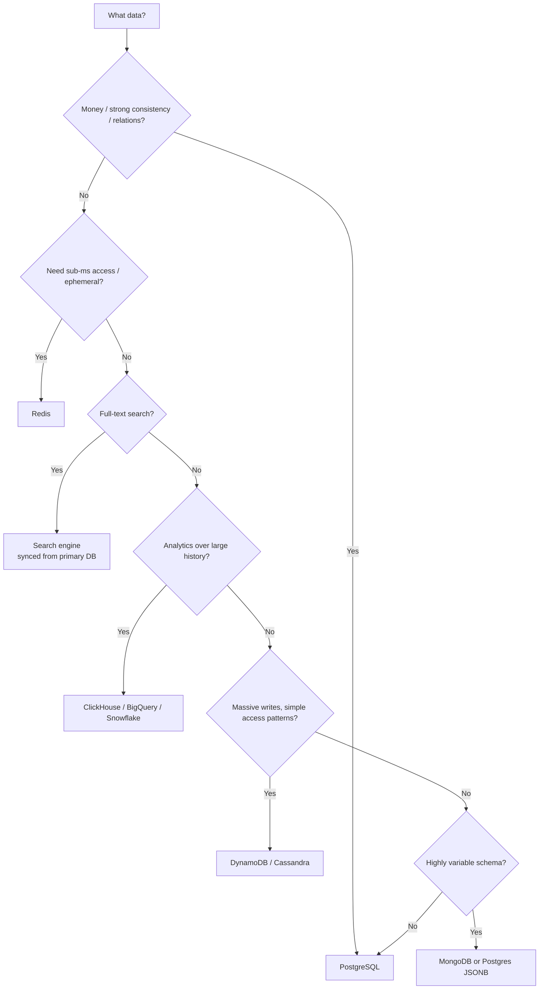

# 08 · Database Selection

## Purpose
Guide the choice of **data storage technology** for each type of data — relational, document, key-value, wide-column, graph, search, time-series, analytics — with use cases and drawbacks.

## When to use
- Designing a new service's data layer
- Performance problems traced to the database
- Adding search, analytics, caching, or real-time features
- Evaluating a migration (e.g., MongoDB → PostgreSQL)

## Use cases
| Data / workload | Recommended | Why |
|---|---|---|
| Orders, payments, users (transactional) | PostgreSQL / MySQL | ACID, joins, constraints |
| Flexible product catalogue | PostgreSQL JSONB or MongoDB | Semi-structured attributes |
| Sessions, cache, rate limiting | Redis / Valkey | In-memory, sub-ms |
| Product / content search | Elasticsearch / OpenSearch / Meilisearch / Typesense | Full-text, relevance, facets |
| Metrics, IoT sensor data | TimescaleDB / InfluxDB / Prometheus | Time-ordered writes, downsampling |
| Social graph, recommendations | Neo4j / Amazon Neptune | Relationship traversal |
| Massive write throughput, global | Cassandra / ScyllaDB / DynamoDB | Horizontal scale, partitioned writes |
| Analytics / BI | BigQuery / Snowflake / Redshift / ClickHouse | Columnar, aggregate queries |
| Files, images, backups | S3 / GCS / Azure Blob | Cheap, durable object storage |
| AI semantic search / RAG | pgvector / Pinecone / Weaviate / Qdrant | Vector similarity |
| Event log / streaming | Kafka (not a DB, but durable log) | Replayable event history |

---

## User guide (non-technical)
- A database is where the app **remembers** things.
- Different data needs different "filing cabinets": a ledger for money (relational), a fast sticky-note board (cache), a library index (search engine).
- Database choices affect **cost, speed, reliability, and the ability to run reports**.

---

## Developer guide

### 1. Database families
| Family | Examples | Strengths | Drawbacks |
|---|---|---|---|
| **Relational (SQL)** | PostgreSQL, MySQL, SQL Server, Oracle, MariaDB | ACID, joins, mature, strong consistency, SQL | Horizontal write scaling is hard; schema migrations needed |
| **Distributed SQL** | CockroachDB, YugabyteDB, Google Spanner, TiDB | SQL + horizontal scale + geo-distribution | Higher latency per write, cost, complexity |
| **Document** | MongoDB, Couchbase, Firestore | Flexible schema, nested data, easy start | Weak joins; schema chaos without discipline; transactions limited/costly |
| **Key-value** | Redis, Valkey, DynamoDB, etcd | Extremely fast, simple | Limited querying; memory cost (Redis) |
| **Wide-column** | Cassandra, ScyllaDB, HBase, Bigtable | Huge write throughput, linear scale | Query-driven modelling, no joins, eventual consistency |
| **Graph** | Neo4j, Neptune, ArangoDB | Relationship queries | Niche skills; scaling limits |
| **Search** | Elasticsearch, OpenSearch, Solr, Meilisearch, Typesense | Full-text, fuzzy, facets | Not a primary store; sync lag; ops-heavy (ES) |
| **Time-series** | TimescaleDB, InfluxDB, Prometheus, QuestDB | Fast time-range queries, retention | Narrow use case |
| **Columnar / OLAP** | ClickHouse, BigQuery, Snowflake, Redshift, DuckDB | Fast aggregations over billions of rows | Poor for single-row updates/transactions |
| **Vector** | pgvector, Pinecone, Weaviate, Qdrant, Milvus | Embedding similarity search | Young ecosystem; approximate results |

### 2. Decision flow

**Default:** Start with **PostgreSQL** — it covers relational, JSON, full-text (basic), vectors (pgvector), and time-series (Timescale) well enough for most products. Add specialised stores only when a measured need appears.

### 3. Data modelling tips
- **Relational:** normalise to 3NF, denormalise selectively for read performance; use foreign keys and constraints.
- **Document:** model around access patterns; embed data read together, reference data shared widely.
- **DynamoDB/Cassandra:** design tables from queries first (single-table design, partition keys to avoid hot partitions).
- Always store money as **integer minor units** or `NUMERIC/DECIMAL`, never float.
- Use UUIDv7 / ULID for distributed IDs if sortable IDs are needed.

### 4. Performance essentials
| Technique | Notes |
|---|---|
| Indexes | Index columns in `WHERE`, `JOIN`, `ORDER BY`; check with `EXPLAIN ANALYZE` |
| Connection pooling | PgBouncer, RDS Proxy, HikariCP |
| Avoid N+1 queries | Eager loading / batching (DataLoader) |
| Pagination | Keyset (cursor) over `OFFSET` for large tables |
| Read replicas | For read-heavy traffic; beware replication lag |
| Partitioning | Large tables by date/tenant |
| Caching | Redis cache-aside for hot reads |

### 5. Operations
- **Managed services** (RDS, Cloud SQL, Azure Database, Atlas, ElastiCache) unless you have DBAs.
- Automated backups + **tested restores** (point-in-time recovery).
- Encryption at rest and TLS in transit.
- Least-privilege DB users per service; no shared root credentials.
- Monitor: connections, slow queries, replication lag, disk, CPU, cache hit ratio.

### 6. ORMs & query tools
| Language | Tools | Drawback |
|---|---|---|
| TypeScript | Prisma, Drizzle, TypeORM, Knex | ORMs can hide inefficient SQL |
| Python | SQLAlchemy, Django ORM | Lazy loading → N+1 |
| Java/Kotlin | Hibernate/JPA, jOOQ, Exposed | Hibernate complexity |
| C# | Entity Framework Core, Dapper | EF change-tracking overhead |
| Go | sqlc, GORM, sqlx | GORM magic; sqlc needs SQL-first workflow |

---

## Drawbacks & trade-offs
| Drawback | Description | Mitigation |
|---|---|---|
| Polyglot persistence | Many DBs = more ops, sync issues | Add a new store only with a clear need |
| NoSQL "schemaless" | Schema lives implicitly in code → inconsistency | Validate schemas in app / DB validators |
| Vendor lock-in | DynamoDB, Firestore, Spanner proprietary APIs | Repository abstraction; weigh managed benefits |
| Data sync (DB → search/cache) | Stale or missing data | CDC (Debezium), outbox pattern, reindex jobs |
| Sharding | Cross-shard queries & rebalancing are hard | Delay until vertical scale + replicas exhausted |
| Cost | Managed DBs & analytics warehouses can be expensive | Right-size, reserved instances, storage tiers |

## Checklist
- [ ] Data type & access patterns documented
- [ ] Consistency requirement defined
- [ ] Primary DB chosen (default PostgreSQL) with justification
- [ ] Indexes defined for main queries
- [ ] Backups & restore tested
- [ ] Migrations tool chosen
- [ ] Monitoring for slow queries and connections

## Related docs
[System Design](01-system-design.md) · [Architecture](02-architecture.md) · [Deployment Flow](07-deployment-flow.md#8-database-migrations-zero-downtime-expand--migrate--contract)
