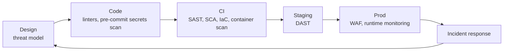

# 10 · Security

## Purpose
Set the **baseline security practices** for building, deploying, and operating applications — authentication, authorisation, secrets, data protection, secure coding (OWASP), and incident response.

## When to use
- Every feature (security is a default, not a phase)
- Handling personal data, payments, or credentials
- Security reviews, audits, pen tests
- Responding to a vulnerability or breach

## Use cases
| Scenario | Key controls |
|---|---|
| User login | OIDC/OAuth2, MFA, password hashing, rate limiting |
| Admin panel | RBAC, audit logs, SSO, IP restrictions |
| Payment flows | PCI scope reduction, webhook signatures, tokenisation |
| Storing PII | Encryption at rest, field-level encryption, retention policy |
| Third-party libraries | Dependency scanning, SBOM, pinning |
| Cloud infrastructure | Least-privilege IAM, network segmentation, IaC scanning |

---

## User guide (non-technical)
- Never share passwords or API keys over chat/email — use the password manager / secrets vault.
- Report suspicious emails (phishing) and incidents immediately to the security channel.
- Enable **MFA** on every work account (Git hosting, cloud console, email).
- Customer data is only accessed when needed for a ticket, and access is logged.

---

## Developer guide

### 1. Authentication (AuthN) — "who are you?"
| Option | Use when | Drawbacks |
|---|---|---|
| Managed identity provider (Auth0, Okta, Cognito, Firebase Auth, Keycloak, Azure Entra ID, Clerk) | Most apps — don't build auth yourself | Cost per MAU, vendor lock-in |
| OAuth 2.0 + OIDC | Social login, SSO, mobile/SPA (Authorization Code + PKCE) | Complex spec, misconfiguration risk |
| Sessions (cookies) | Server-rendered web apps | Needs CSRF protection, server-side store |
| JWT access tokens | APIs, microservices | Hard to revoke → keep short TTL + refresh tokens |
| API keys | Server-to-server partners | Easily leaked; scope and rotate them |
| Passkeys / WebAuthn | Phishing-resistant passwordless | Device/UX support still maturing in places |

Rules: hash passwords with **Argon2id / bcrypt**, enforce MFA for admins, rate-limit login, secure cookie flags (`HttpOnly`, `Secure`, `SameSite`).

### 2. Authorisation (AuthZ) — "what can you do?"
| Model | Description | Drawback |
|---|---|---|
| RBAC | Roles → permissions | Role explosion in complex orgs |
| ABAC | Policies on attributes (dept, region, owner) | Harder to reason about |
| ReBAC | Relationship-based (Google Zanzibar style: OpenFGA, SpiceDB) | New concepts, extra service |

Always enforce **on the server**, check **object ownership** (prevent IDOR), and deny by default.

### 3. OWASP Top 10 — quick defenses
| Risk | Defense |
|---|---|
| Broken access control | Server-side checks on every request, deny by default |
| Cryptographic failures | TLS 1.2+, encrypt sensitive data at rest, no homemade crypto |
| Injection (SQL, NoSQL, command) | Parameterised queries / ORM, input validation |
| Insecure design | Threat modelling (STRIDE) during design |
| Security misconfiguration | Hardened defaults, IaC scanning, disable debug in prod |
| Vulnerable components | SCA scanning, Dependabot/Renovate, SBOM |
| Identification & auth failures | MFA, managed IdP, session expiry |
| Software & data integrity failures | Signed artifacts (Sigstore/cosign), pinned CI actions |
| Logging & monitoring failures | Centralised security logs + alerts |
| SSRF | Allowlist outbound hosts, block metadata endpoints |

Also: XSS (output encoding, CSP), CSRF (SameSite cookies, tokens), clickjacking (`frame-ancestors`), open redirects.

### 4. Secrets management
- Store in **Vault / AWS Secrets Manager / Azure Key Vault / GCP Secret Manager / Doppler / 1Password**.
- **Never** commit secrets; run Gitleaks/TruffleHog in pre-commit + CI.
- Use **OIDC workload identity** from CI to cloud (no static keys).
- Rotate regularly and immediately after exposure.
- `.env` files only for local dev, git-ignored, with `.env.example` committed.

### 5. Data protection
- Classify data: Public / Internal / Confidential / Restricted (PII, payment).
- Encrypt in transit (TLS) and at rest (KMS-managed keys).
- Mask PII in logs; never log passwords, tokens, card data.
- Retention & deletion policies (GDPR/DPDP Act right to erasure).
- Backups encrypted and access-restricted.

### 6. Infrastructure security
- Least-privilege IAM roles per service.
- Private subnets for DBs; only load balancers public.
- WAF (Cloudflare, AWS WAF) for public endpoints; DDoS protection.
- Container images: minimal base, non-root, scanned, signed.
- Kubernetes: network policies, Pod Security Standards, RBAC.

### 7. Security in the SDLC (DevSecOps)

### 8. Incident response (summary)
1. **Detect** — alert or report.
2. **Contain** — revoke keys, block IPs, disable feature.
3. **Eradicate** — patch vulnerability.
4. **Recover** — restore service, verify.
5. **Post-mortem** — blameless review, action items.
6. **Notify** — customers/regulators if required (e.g., GDPR 72 h, CERT-In 6 h in India).

---

## Drawbacks & trade-offs
| Drawback | Mitigation |
|---|---|
| Security friction slows delivery | Automate checks in CI; paved-road templates |
| Scanner false positives / alert fatigue | Tune rules, risk-based triage |
| Managed IdP cost & lock-in | Use standard OIDC so you can switch |
| Short-lived tokens hurt UX | Silent refresh with refresh tokens |
| Over-restrictive IAM breaks deployments | Iterate with access analyzer tools; test in staging |

## Checklist
- [ ] AuthN via managed IdP / OIDC; MFA for admins
- [ ] AuthZ checked server-side for every resource
- [ ] Inputs validated; queries parameterised
- [ ] Secrets in a vault; secret scanning on
- [ ] Dependencies & images scanned in CI
- [ ] PII encrypted and masked in logs
- [ ] Security headers set (CSP, HSTS, X-Content-Type-Options)
- [ ] Incident response contacts documented

## Related docs
[CI/CD Flow](05-ci-cd-flow.md) · [Payment Integration](06-payment-integration.md) · [API Design](09-api-design.md)
