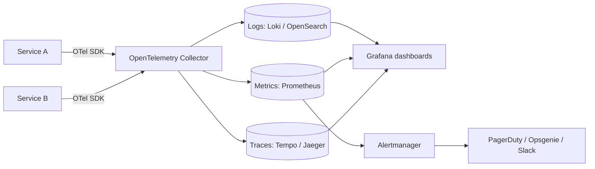

# 11 · Observability (Logging, Monitoring, Tracing, Alerting)

## Purpose
Make running systems **understandable from the outside** — so we detect problems before customers do, find root causes fast, and measure reliability against targets.

## When to use
- Every service in staging and production
- Defining reliability targets (SLOs)
- Debugging production incidents
- Validating deployments (canary analysis)

## Use cases
| Question | Signal |
|---|---|
| "Is the site up?" | Uptime checks, health endpoints |
| "Why is checkout slow?" | Distributed traces |
| "How many payments failed in the last hour?" | Metrics |
| "What exactly happened to order 123?" | Structured logs with correlation ID |
| "Did the deploy break anything?" | Error rate & latency dashboards per version |
| "Are users having a bad experience on mobile?" | RUM / crash reporting |

---

## User guide (non-technical)
- **Dashboards** show the health of the system (traffic, errors, speed).
- **Alerts** wake up the on-call engineer when something is wrong.
- **Status page** tells customers about incidents.
- When reporting a bug, include **time, user/order ID, and screenshot** — this lets engineers find the exact logs.

---

## Developer guide

### 1. The three pillars (+ more)
| Signal | What | Tools | Drawbacks |
|---|---|---|---|
| **Logs** | Discrete events with context | ELK/OpenSearch, Loki, CloudWatch, Datadog, Splunk | Expensive at volume; noisy |
| **Metrics** | Numeric time series | Prometheus, Grafana, Datadog, CloudWatch, New Relic | Limited context; cardinality explosion |
| **Traces** | Request path across services | OpenTelemetry + Jaeger, Tempo, Zipkin, Datadog APM, Honeycomb | Instrumentation effort; sampling decisions |
| **Errors** | Exceptions with stack traces | Sentry, Rollbar, Bugsnag | Duplicate noise if not grouped |
| **RUM / mobile** | Real user performance & crashes | Sentry, Datadog RUM, Firebase Crashlytics | Privacy considerations |
| **Synthetic** | Scripted checks from outside | Checkly, Pingdom, UptimeRobot, Grafana synthetic | Only checks what you script |

**Standard:** instrument with **OpenTelemetry** (vendor-neutral), export to the backend of choice.

### 2. Architecture


### 3. Structured logging
```json
{
  "timestamp": "2026-11-27T10:15:02.123Z",
  "level": "error",
  "service": "payments-api",
  "version": "1.5.0",
  "env": "production",
  "traceId": "4bf92f3577b34da6a3ce929d0e0e4736",
  "userId": "u_8812",
  "orderId": "ord_552",
  "message": "Gateway timeout while capturing payment",
  "durationMs": 30001
}
```
Rules: JSON logs, consistent fields, **correlation/trace ID** propagated across services, no PII/secrets, appropriate levels (`debug` off in prod).

### 4. What to measure
- **RED** (for request-driven services): **R**ate, **E**rrors, **D**uration.
- **USE** (for resources): **U**tilisation, **S**aturation, **E**rrors.
- **Golden signals:** latency, traffic, errors, saturation.
- **Business metrics:** orders/min, payment success rate, signups, revenue.

### 5. SLIs, SLOs, error budgets
| Term | Example |
|---|---|
| SLI (indicator) | % of checkout requests that succeed in < 500 ms |
| SLO (objective) | 99.9% over 30 days |
| Error budget | 0.1% ≈ 43 min/month of "bad" — when spent, freeze risky releases |
| SLA (agreement) | Contractual promise to customers (looser than SLO), with penalties |

### 6. Alerting principles
- Alert on **symptoms users feel** (error rate, latency, SLO burn rate), not every CPU spike.
- Every alert must be **actionable** and link to a **runbook**.
- Severity levels: P1 (page now), P2 (page in hours), P3 (ticket).
- Review noisy alerts weekly; delete or tune.

### 7. Incident management
On-call rotation (PagerDuty/Opsgenie/incident.io) → incident channel → incident commander → status page (Statuspage, Instatus) → blameless post-mortem with action items.

---

## Drawbacks & trade-offs
| Drawback | Mitigation |
|---|---|
| Cost grows with data volume (esp. SaaS like Datadog/Splunk) | Sampling, log levels, retention tiers, drop noisy logs |
| High-cardinality metrics blow up storage | Avoid user IDs in metric labels; use traces/logs for that |
| Alert fatigue | SLO-based alerting, regular tuning |
| Instrumentation effort | Auto-instrumentation via OpenTelemetry agents |
| Self-hosting (Prometheus/Grafana/Loki) ops burden | Managed offerings (Grafana Cloud, AWS Managed Prometheus) |
| PII leaking into logs | Redaction processors in collector, code reviews |

## Checklist
- [ ] Structured JSON logs with trace ID
- [ ] RED metrics + business metrics exposed
- [ ] Distributed tracing via OpenTelemetry
- [ ] Error tracking (Sentry or similar) configured
- [ ] SLOs defined for critical journeys
- [ ] Alerts actionable with runbooks
- [ ] Dashboards per service + deploy markers
- [ ] On-call rotation & status page set up

## Related docs
[Deployment Flow](07-deployment-flow.md) · [System Design](01-system-design.md) · [Security](10-security.md)
