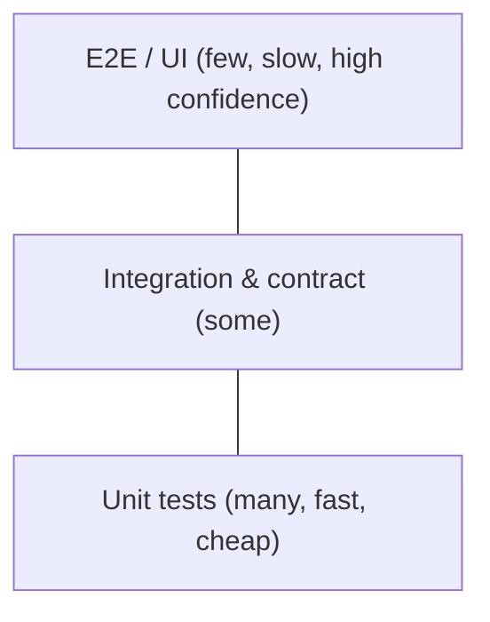

# 12 · Testing Strategy

## Purpose
Define **what to test, at which level, with which tools**, and how testing fits into CI/CD — so we ship with confidence without slow, brittle test suites.

## When to use
- Writing any new code or fixing a bug (add a regression test)
- Setting up a new project's test tooling
- Deciding release readiness
- Investigating flaky or slow tests

## Use cases
| Scenario | Test type |
|---|---|
| Price calculation logic | Unit tests |
| Repository writes to Postgres | Integration test (Testcontainers) |
| Order service ↔ Payment service contract | Contract test (Pact) |
| User completes checkout in browser | E2E test (Playwright) |
| Black Friday traffic | Load test (k6) |
| SQL injection / auth bypass | Security test (DAST, pen test) |
| Button readable by screen readers | Accessibility test (axe) |

---

## User guide (non-technical / QA)
- **Automated tests** run on every change in the pipeline.
- **QA/UAT on staging** focuses on exploratory testing, new features, and business acceptance.
- Bug reports should include: steps to reproduce, expected vs actual, environment, screenshots/video, user/order IDs.
- Severity: **Blocker** (no workaround, stops release) → **Critical** → **Major** → **Minor** → **Trivial**.

---

## Developer guide

### 1. Test pyramid

Aim roughly for **70% unit / 20% integration / 10% E2E** (adjust per app — frontend-heavy apps may favour the "testing trophy" with more integration tests).

### 2. Test types
| Type | Scope | Tools | Drawbacks |
|---|---|---|---|
| Unit | Single function/class | Jest, Vitest, pytest, JUnit 5, xUnit/NUnit, Go testing | Mocks can hide real integration bugs |
| Component (frontend) | UI component in isolation | React Testing Library, Vue Test Utils, Storybook tests | Doesn't catch layout/browser issues |
| Integration | Module + real DB/queue | Testcontainers, docker-compose, Supertest | Slower; needs Docker in CI |
| Contract | API agreement between services | Pact, Spring Cloud Contract, schema diff | Setup overhead, broker needed |
| E2E | Full user journey | Playwright, Cypress, Selenium, Appium (mobile), Detox | Slow, flaky, costly to maintain |
| Performance / load | Throughput & latency | k6, JMeter, Gatling, Locust | Needs prod-like environment |
| Security | Vulnerabilities | OWASP ZAP, Burp, Semgrep | False positives |
| Accessibility | WCAG compliance | axe-core, Lighthouse, Pa11y | Automated tools catch only ~30–40% of issues |
| Visual regression | UI pixel changes | Chromatic, Percy, Playwright snapshots | Noisy diffs from fonts/rendering |
| Mutation | Test-suite quality | Stryker, PIT, mutmut | Very slow |

### 3. Writing good tests
- **Arrange → Act → Assert**; one behaviour per test.
- Name tests by behaviour: `should_reject_payment_when_amount_is_negative`.
- Test **behaviour, not implementation** details.
- Deterministic: no real time, randomness, or network — inject clocks, seed randoms, mock external APIs.
- Use **factories/fixtures** for test data; isolate DB per test (transactions or truncate).
- Every bug fix ships with a **regression test**.

### 4. Example (TypeScript + Vitest)
```ts
import { describe, it, expect } from 'vitest';
import { calculateTotal } from './cart';

describe('calculateTotal', () => {
  it('applies percentage discount and rounds to minor units', () => {
    const items = [{ price: 19999, qty: 2 }];       // paise
    expect(calculateTotal(items, { percentOff: 10 })).toBe(35998);
  });

  it('throws on negative quantity', () => {
    expect(() => calculateTotal([{ price: 100, qty: -1 }])).toThrow('Invalid quantity');
  });
});
```

### 5. Tests in CI
| Trigger | Run |
|---|---|
| Pre-commit | Lint, format, affected unit tests (optional) |
| Pull request | Unit + integration + contract + coverage gate |
| Merge to main | + E2E on staging, DAST |
| Nightly | Full E2E matrix, load test, mutation (optional) |
| Pre-release | Regression + UAT sign-off |

Coverage: target **≥ 80% on new/changed code**, but don't chase 100% — coverage measures executed lines, not correctness.

### 6. Test environments & data
- Use anonymised/synthetic data; never copy raw production PII into test envs.
- Seed scripts for repeatable states.
- Mock third parties (payment gateways' test mode, WireMock, MSW, LocalStack for AWS).

### 7. Managing flaky tests
1. Detect (CI flake reports / retry analytics).
2. Quarantine (tag & skip from blocking suite).
3. Fix root cause (waits, shared state, order dependence, time).
4. Re-enable.

---

## Drawbacks & trade-offs
| Drawback | Mitigation |
|---|---|
| Too many E2E tests → slow, flaky pipeline | Push checks down the pyramid |
| Over-mocking → false confidence | Integration tests with real dependencies via containers |
| Coverage targets gamed | Review test quality, mutation testing on critical modules |
| Maintenance cost when UI changes | Stable selectors (`data-testid`, roles), page objects |
| Load tests in shared staging affect others | Dedicated perf environment or off-hours scheduling |

## Checklist
- [ ] Unit tests for business logic
- [ ] Integration tests for DB/external adapters
- [ ] Contract tests for service APIs (if microservices)
- [ ] E2E for critical journeys (login, checkout, payment)
- [ ] Regression test for every bug fix
- [ ] Tests run in CI and block merges
- [ ] Flaky tests tracked and quarantined

## Related docs
[CI/CD Flow](05-ci-cd-flow.md) · [Payment Integration](06-payment-integration.md#11-testing-payments) · [Security](10-security.md)
