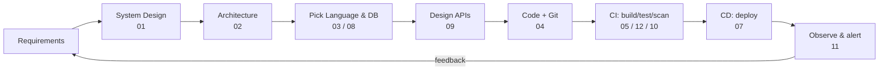

# Project Documentation Hub

Welcome! This folder is the single source of truth for **how we design, build, ship, and run** our applications.
Every topic lives in its own file and follows the same structure so you always know where to look.

## How every document is structured

| Section | What you'll find |
|---|---|
| **Purpose** | Why this document exists and what problem it solves |
| **When to use** | The situations where this guidance applies |
| **Use cases** | Concrete, real-world examples |
| **User guide** | How a non-developer (PM, QA, support, ops) should understand / use it |
| **Developer guide** | Step-by-step technical instructions, commands, code |
| **Drawbacks & trade-offs** | What it costs you, where it breaks, what to watch out for |
| **Checklist** | A quick "am I done?" list |

## Index

| # | Document | One-line summary |
|---|---|---|
| 01 | [System Design](01-system-design.md) | Requirements, scaling, caching, queues, CAP, capacity planning |
| 02 | [Architecture](02-architecture.md) | Monolith vs modular monolith vs microservices vs serverless vs event-driven |
| 03 | [Languages & Use Cases](03-languages-and-usecases.md) | Which language to pick, when, where, and why not |
| 04 | [Git Workflow](04-git-workflow.md) | Branching strategies, commit conventions, PRs, releases |
| 05 | [CI/CD Flow](05-ci-cd-flow.md) | Pipeline stages, tools, quality gates, sample pipelines |
| 06 | [Payment Integration](06-payment-integration.md) | Gateways, checkout flows, webhooks, refunds, PCI, tools |
| 07 | [Deployment Flow](07-deployment-flow.md) | Environments, strategies (blue-green, canary), rollback, hosting |
| 08 | [Database Selection](08-database-selection.md) | SQL vs NoSQL vs cache vs search vs time-series |
| 09 | [API Design](09-api-design.md) | REST, GraphQL, gRPC, WebSockets, versioning, errors |
| 10 | [Security](10-security.md) | AuthN/AuthZ, secrets, OWASP Top 10, encryption |
| 11 | [Observability](11-observability.md) | Logs, metrics, traces, alerting, SLOs |
| 12 | [Testing Strategy](12-testing-strategy.md) | Test pyramid, unit/integration/E2E, tools |
| 13 | [Tech Stack & Tools Matrix](13-tech-stack-and-tools.md) | Every tool we reference, its purpose, alternatives, drawbacks |

## Suggested reading order

- **New developer:** 02 → 03 → 04 → 05 → 07 → 12
- **Architect / tech lead:** 01 → 02 → 08 → 09 → 10 → 11
- **Product / QA / Support:** README → 04 (user guide) → 06 (user guide) → 07 (user guide)
- **Building payments:** 06 → 10 → 09 → 11

## End-to-end lifecycle (how the docs connect)

## Contributing to these docs

1. Keep **one topic per file**. If a section grows past ~400 lines, split it.
2. Always include a **Drawbacks** section — no tool or pattern is free.
3. Use Mermaid for diagrams so they render on GitHub/GitLab.
4. Update the index table above when adding a file.
5. Open a PR with the `docs:` commit prefix (see [Git Workflow](04-git-workflow.md)).
